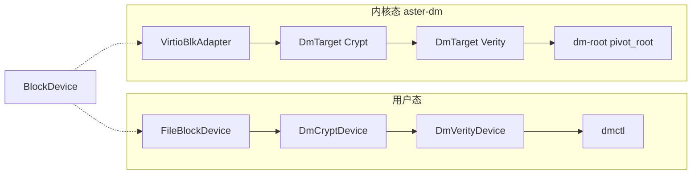

# 星绽操作系统 dm-crypt / dm-verity

全国大学生计算机系统能力大赛操作系统设计赛功能挑战项目。

| 项目 | 信息 |
|---|---|
| 队伍 | Go_Go_Go |
| 学校 | 华南师范大学 |
| 成员 | 张乐桁、陈韵、潘利源 |
| 赛题 | 面向 Rust OS 的高性能可信存储实现 |
| 演示视频 | [百度网盘：操作系统竞赛](https://pan.baidu.com/s/1aDbv9a4HCEqz8pUGUqma9A?pwd=oscp)，提取码 `oscp` |
| 答辩材料 | PPT（PPTX/PDF）与 8 分钟视频已通过希冀专门入口提交 |
| 上游内核 | [`asterinas/`](asterinas/) 软链接 [Asterinas 官方仓库](https://github.com/asterinas/asterinas) |
| 技术文档 |  [设计赛道](docs/design_doc/design_doc.pdf) · [设计赛道源码](docs/design_doc/) |

两份 PDF 互为补充：设计赛道按大赛大纲写题目分析、计划、进展、测试、问题、分工；技术文档写架构、AES-XTS / Merkle 算法、合规与用户手册。

---

## 1. 目标描述

| 赛题指标 | 状态 | 证据 |
|---|---|---|
| dm-verity 基础功能（哈希树、SHA-256、启动参数） | 已完成 | R03 / V01 PASS |
| dm-crypt 基础功能（透明加解密、支撑 cryptsetup） | 已完成 | R01、C01–C05 PASS |
| 根文件系统加密 | 已完成 | R02 PASS |
| 性能与启动要求 | 已完成 | 五轮矩阵；verity 启动开销 2.75% |
| 技术探索（Rust OS 存储优化） | 已完成 | AES-NI、hash cache、scratch pool、BIO 复用 |


机密计算 Guest 里内存可受 TEE 保护，rootfs 仍落在宿主机不可信介质上，面临明文可读、离线篡改和整盘替换。Linux 用 Device Mapper 的 `dm-crypt` / `dm-verity` 补机密性与完整性。星绽是 Framekernel + OSTD 的 Rust OS，BIO、设备注册和启动流程与 Linux 不同，不能移植 C 实现。本项目用 Rust 补这一层：算法与 Linux `aes-xts-plain64`、SHA-256 Merkle 布局对齐，同时落到用户态 `dmctl` 和内核 `aster-dm`。

五项功能目标：

1. **dm-verity**：SHA-256 Merkle 树，块大小 4096；on-disk 哈希树；root hash 经 `rootfs_verity.hash` 注入；读路径校验到根；只读；认证后哈希缓存（先认证、后插入）。
2. **dm-crypt**：AES-256-XTS、512 位密钥、`plain64` IV；与 Linux 逐字节一致（固定向量 SHA-256 `4334c17f…`）；支持 `iv_offset` / `data_offset` 等表选项；scratch pool 默认 32。
3. **受保护根**：启动参数配置 crypt / verity；`dm_stack=crypt,verity` 组合；initramfs 挂 mapper 后 `pivot_root`，串口 `PASS system root switched to protected mapper`。
4. **Linux 兼容**：`/dev/mapper/control` 上 `dm_ioctl` 子集，支撑 cryptsetup plain 模式；LUKS2 的 PBKDF 仍在用户态；`dmctl` 做镜像级演示。
5. **性能**：256 MiB 合同 4K 同步读 raw 4.249、crypt 4.059（95.6%）、verity 3.815（87.3%）；启动 crypt +0.58%、verity +2.75%。完整表见第 6 章。

创新点：AES-NI（日志 `backend=AES-NI`）、scratch pool、认证后 hash cache（`auth_shortcuts`）、4 KiB 对齐 BIO 复用（`data_rereads=0`）、`TargetCapabilities` 沿栈传播。

需求对应见 [需求映射](docs/requirement_mapping.md)。

---

## 2. 题目分析与调研

| 调研方向 | 发现 | 对本项目的约束 |
|---|---|---|
| Linux Device Mapper | crypt 用 XTS-AES + plain64；verity 用 SHA-256 Merkle + on-disk 树 | 必须逐字节兼容，否则 cryptsetup 不能互操作 |
| Asterinas | Framekernel、BIO 异步、`no_std` | 不能复用 Linux 代码，补丁接入 `aster-block` |
| AES-XTS | NIST SP 800-38E；Linux AES-256-XTS 双密钥 | 扇区级 IV，固定向量验证 |
| SHA-256 | FIPS 180-4；摘要 32 字节 | 纯 Rust，无外部哈希库 |
| Rust 系统编程 | 所有权、trait、`no_std` | 用类型编码安全能力 |

赛题五条：verity 哈希树与启动参数；crypt 透明加解密并支撑 cryptsetup；加密根文件系统；吞吐延迟接近 Linux 且 verity 不明显拖长 boot；Rust OS 上的存储优化。测试环境是 QEMU，存储口是 virtio-blk。

难点不在“会写 AES”，而在：Asterinas 没有 Linux 的 `struct bio` / `request_queue`；IV 必须按 512 字节扇区拆 4 KiB BIO；Device Mapper 要同时接 BIO、`/dev/mapper/control` 和启动切根；缓存不能削弱 root hash 信任链。

Linux 侧职责分层：cryptsetup 做 LUKS2 header 与 PBKDF，内核只吃 volume key 和 dm-crypt table。本项目同样如此。verity 每 128 个 32 字节哈希装进一个 4096 字节哈希块。Asterinas 用 `Components.toml` 把 `aster-dm` 做成独立组件，启动走 initramfs + `pivot_root`。

---

## 3. 系统框架

| 设计维度 | 决策 | 收益 |
|---|---|---|
| 核心抽象 | `BlockDevice` trait | 后端与 mapper 可互换、可堆叠 |
| 架构 | 装饰器 + 组合 | `Passthrough → Crypt → Verity` |
| 双目标 | 核心逻辑与平台无关 | 用户态验算法，内核态走真 BIO |
| 同步 | 用户态 `Mutex`；内核 `spin::Mutex` + 关抢占 | AES-NI 期间 XMM 不被打断 |
| 能力传播 | `TargetCapabilities` | 组合栈机密性 / 完整性 / 只读可静态汇总 |
| 可观测 | 原子计数器 + 阶段计时 | `/proc/dm-*-stats` 归因 |

```rust
pub trait BlockDevice: Send + Sync {
    fn block_size(&self) -> usize;
    fn num_blocks(&self) -> u64;
    fn read_block(&self, block_id: u64, buf: &mut [u8]) -> Result<()>;
    fn write_block(&self, block_id: u64, buf: &[u8]) -> Result<()>;
}
```

用户态叠栈示例：`FileBlockDevice → DmCryptDevice → DmVerityDevice`。内核里 `DmDevice` 按 `DmTarget::{Passthrough,Crypt,Verity}` 分发 BIO；下层是 `Arc<dyn BlockDevice>`，启动参数可以把 `rootfs_verity.device` 指到 `dm-crypt0`，或设 `dm_stack=crypt,verity`，得到 `vdc → dm-crypt0 → dm-verity0`。

| 模块 | 职责 | 约行数 |
|---|---|---|
| `block_device` | 抽象与文件/内存后端 | 400 |
| `dm_crypt` | AES-XTS 透明加密 | 350 |
| `dm_verity` | 只读完整性 | 200 |
| `hash_tree` | Merkle 构建与校验 | 150 |
| `sha256` | 纯 Rust SHA-256 | 120 |
| `device_mapper` | 链接与 `DmStackBuilder` | 180 |
| `statistics` | I/O 与阶段归因 | 150 |
| `runtime` | 运行时 mapper / dm_ioctl | 260 |

用户态约 3000 行（`crates/dm`）+ `dmctl` 约 800 行；内核补丁 0001–0007 约 4000 行。不是两套互不相干的实现：用户态是算法与布局的安全网，内核态才是赛题交付物。



| 功能 | 用户态（dmctl） | 内核态（aster-dm） |
|---|---|---|
| 代码 | [`crates/dm/`](crates/dm/)、[`crates/dmctl/`](crates/dmctl/) | `asterinas/kernel/comps/dm/`，补丁 [`asterinas_port/patches/`](asterinas_port/patches/) 0001–0007 |
| 块设备后端 | `FileBlockDevice` / `MemoryBlockDevice` | `VirtioBlkAdapter`（virtio-blk BIO） |
| 加密映射器 | `DmCryptDevice` | `DmTarget::Crypt` |
| 完整性映射器 | `DmVerityDevice` | `DmTarget::Verity` |
| 组合构建器 | `DmStackBuilder` / `demo-stack` | `dm_stack=crypt,verity`（补丁 0007） |
| 控制接口 | 命令行、`crypt-table-fill` | `/dev/mapper/control`（供 cryptsetup） |
| 同步 | `std::sync::Mutex` | `spin::Mutex` + `disable_preempt` |

**crypt 写路径**：按块号算扇区 → scratch 缓冲 → AES-XTS（扇区号作 plain64 IV）→ 下层设备。读路径相反。4 KiB 块拆成 8 个 512 字节扇区分别变换，才能和 Linux 一致。

**verity 读路径**：读数据块 → SHA-256 → 沿 on-disk 树或认证后缓存走到 root hash → 不一致则 `IntegrityViolation`。写一律拒绝。

内核启用 `dm.perf_stats=1` 后，crypt 热路径里下层等待约占 97.84%、AES-XTS 约占 1.82%；verity 下层等待约占 93.01%、数据 SHA-256 约占 5.74%。算法本身不是主瓶颈，所以优化优先做缓冲池、缓存和 BIO 复用，而不是再改一轮 AES。

补丁用法见 [asterinas_port/README.md](asterinas_port/README.md)。算法展开见技术文档第 3、4 章。

---

## 4. 开发计划

| 阶段 | 时间 | 内容 | 交付 |
|---|---|---|---|
| 一 | 06-23 – 06-28 | 用户态核心 | `dm` crate、`dmctl`、单元测试 |
| 二 | 06-29 – 07-10 | Linux 兼容 | XTS 逐字节、cryptsetup plain |
| 三 | 07-11 – 07-20 | 内核 BIO | 补丁 0001–0004、切根 |
| 四 | 07-21 – 07-31 | 性能框架 | 补丁 0005–0006、FIO 脚本 |
| 五 | 08-01 – 08-11 | 组合栈与正式矩阵 | 补丁 0007、五轮证据 |
| 六 | 08-09 – 08-14 | 文档与答辩 | 两份 PDF、PPT、视频 |

方法论：先用户态后内核；每个补丁一个可验收增量；测完再优化；文档跟代码走。全程约 50 天（2026-06-23 至 08-14）。

---

## 5. 重要进展

| 阶段 | 时间 | 成果 | 验证 |
|---|---|---|---|
| 用户态核心 | 06-23 – 06-28 | `dm` + `dmctl`，约 1500 行 | 13+ 单元测试；`ciphertext_differs` / `tamper_detected` |
| Linux 兼容 | 06-29 – 07-10 | XTS 逐字节；`/dev/mapper/control` | 固定向量 SHA-256 匹配 |
| 内核集成 | 07-11 – 07-20 | 补丁 0001–0004 | R01–R03、C01–C05 等 KVM PASS |
| 性能优化 | 07-21 – 07-31 | AES-NI、scratch、hash cache、归因 | 串口 `AES-NI` |
| 组合与验收 | 08-01 – 08-11 | 补丁 0007；46 PASS | `review_release_check.py` PASS |
| 文档答辩 | 08-09 – 08-14 | PDF、PPT、视频 | 提交托管平台 |

补丁对应关系：0001 组件骨架与 target；0002 BIO / ext2 魔数自检；0003 `dm-root` + `pivot_root`；0004 `dm_ioctl`；0005 性能优化；0006 阶段归因；0007 组合栈。早期 FIO 曾把不存在的 mapper 测成普通文件，判为 `HARNESS_BUG`，已从正式生成输入剔除。

---

## 6. 系统测试

测试分四层，不要拿用户态 `cargo test` 代替 KVM 门禁：

1. 用户态：`cargo test --workspace`
2. Linux 兼容：`verify_linux_xts_compat.sh`
3. 内核正确性：R01–R03、C01–C05、V01–V07
4. 内核正式性能：下列 FIO / Filebench / SQLite / boot（不要和 `dmctl benchmark` 混读）

固定环境：Asterinas 官方镜像 `asterinas/asterinas:0.18.0-20260618`、x86_64、QEMU/KVM、`-cpu host`、1 vCPU、**8 GiB**。正确性结论见 [KVM 正确性报告](KVM_CORRECTNESS_REPORT.md)；变异位置见 [物理变异清单](PHYSICAL_MUTATION_MANIFEST.md)。

| 编号 | 内容 | 结果 |
|---|---|---|
| R01 | cryptsetup open/read/close | PASS |
| R02 | dm-crypt 受保护 rootfs | PASS |
| R03 / V01 | dm-verity 正常 rootfs 与正确 root hash | PASS |
| C01–C05 | 正确密钥、错误密钥、4/32/256 KiB 往返 | PASS |
| V02 | 错误 root hash | PASS |
| V03–V07 | 首/中/末数据块、叶子/中间 hash 单字节损坏 | PASS |

V03–V07 只翻转清单里的一个字节，继续用原始正确 root hash；损坏数据不得交付、不得 fallback 到 lower device。

### 性能完成情况

数字来自内核态 KVM 真 mapper，均为 5 轮中位数。Linux 与 Asterinas 分表，不跨平台算倍率。原始表见 [PERFORMANCE_MATRIX.csv](docs/evidence/final-performance-20260811/PERFORMANCE_MATRIX.csv)，说明见 [中文性能报告](docs/evidence/final-performance-20260811/PERFORMANCE_VALIDATION_REPORT.md)。

正式 FIO **46 PASS + 6 只读 N/A**；Filebench / SQLite / Boot 各五轮。有效单元格保留全部轮次，不剔除异常值。

| 范围 | 有效单元格 | 结果 |
|---|---|---|
| Asterinas KVM dm-crypt | 13 项 × 5 轮 | PASS |
| Asterinas KVM dm-verity | 7 项 × 5 轮 | PASS（6 项写 N/A） |
| Linux QEMU virtio raw | 13 项 × 5 轮 | PASS |
| Linux QEMU virtio dm-crypt | 13 项 × 5 轮 | PASS |
| Linux QEMU virtio dm-verity 读 | 7 项 × 5 轮 | PASS（6 项写 N/A） |

| 补充测试 | 轮数 | 结果 | 证据 |
|---|---|---|---|
| Filebench fileserver | raw 5 + dm-crypt 5 | PASS；verity 只读 N/A | `docs/evidence/linux-qemu-filebench-sqlite-20260817/filebench/` |
| SQLite 10,000 行 | raw 5 + dm-crypt 5 + dm-verity 5 | PASS | `docs/evidence/linux-qemu-filebench-sqlite-20260817/sqlite/` |
| Asterinas 启动耗时 | plain 5 + dm-crypt 5 + dm-verity 5 | PASS | `docs/evidence/final-performance-20260811/boot-matrix/` |

### 256 MiB 正式合同：Asterinas raw / dm-crypt / dm-verity

KVM、1 vCPU、8 GiB、virtio-blk、4 KiB 同步读、QD1、10 秒 runtime、交替顺序五轮。raw 行合并两组共十次测量；target 的相对值使用同一镜像、同一轮次合同的配对 raw 中位数。

| 设备 | 五轮中位吞吐（MiB/s） | 中位 p50（us） | 中位 p95（us） | 相对配对 raw |
|---|---:|---:|---:|---:|
| raw（两组共十轮） | 4.249 | 892.928 | 1277.952 | 100.0% |
| dm-crypt | 4.059 | 921.600 | 1318.912 | 95.6% |
| dm-verity | 3.815 | 954.368 | 1433.600 | 87.3% |

阶段差值：dm-crypt 下层等待中位占 97.84%、AES-XTS 占 1.82%；dm-verity 下层等待中位占 93.01%、数据 SHA-256 占 5.74%。

### Linux guest 与 Asterinas 同条件对照

同一宿主机、KVM、CPU=host、1 vCPU、8 GiB、同一 virtio-blk 数据盘前 256 MiB、4 KiB、sync、direct=1、QD1、ramp 2 秒、runtime 10 秒：

| 系统 | raw 中位吞吐（MiB/s） | dm-crypt 中位吞吐（MiB/s） | dm-crypt 保留率 | dm-crypt p95（us） | dm-verity 中位吞吐（MiB/s） | dm-verity 保留率 |
|---|---:|---:|---:|---:|---:|---:|
| Linux guest | 5.150 | 4.746 | 92.158% | 1384.448 | 4.369 | 94.1% |
| Asterinas | 4.245 | 4.059 | 95.621% | 1318.912 | 3.815 | 87.3% |

Asterinas 的 raw、dm-crypt、dm-verity 绝对吞吐分别为 Linux guest 的 **82.4%**、**85.5%**、**87.3%**（verity 为 3.815 / 4.369）。95.621% 与 87.3% 分别是 Asterinas 相对自身 raw / 配对 raw 的 dm-crypt 与 dm-verity 保留率，不代表绝对吞吐超过 Linux。dm-crypt 保留率相对表中 raw 列；dm-verity 保留率相对配对 raw（Linux 4.641、Asterinas 4.368）。

### Linux FIO：QEMU/KVM virtio-blk（raw / dm-crypt / dm-verity）

QEMU/KVM、`-cpu host`、1 vCPU、8 GiB、virtio-blk、受测区 256 MiB、fio 3.36、`libaio`、`direct=1`、`numjobs=1`、**qd=1**、5 轮中位。证据：`docs/evidence/linux-qemu-fio-20260816/`。

| workload | bs | raw | dm-crypt | dm-verity |
|---|---:|---:|---:|---:|
| read | 4K | 11.391 | 10.942 | 10.704 |
| read | 32K | 73.074 | 68.706 | 67.859 |
| read | 256K | 134.623 | 129.474 | 122.088 |
| randread | 4K | 10.673 | 10.703 | 10.245 |
| randread | 32K | 69.902 | 67.168 | 65.493 |
| randread | 256K | 136.823 | 128.612 | 123.775 |
| write | 4K | 11.490 | 10.992 | N/A（只读） |
| write | 32K | 73.705 | 69.765 | N/A（只读） |
| write | 256K | 129.087 | 119.888 | N/A（只读） |
| randwrite | 4K | 10.811 | 10.479 | N/A（只读） |
| randwrite | 32K | 71.927 | 68.253 | N/A（只读） |
| randwrite | 256K | 130.124 | 109.453 | N/A（只读） |

### Asterinas KVM FIO：真实保护 mapper

单位：MiB/s。KVM、1 vCPU、8 GiB、virtio-blk、**qd=1**、五轮中位。

| workload | bs | raw | dm-crypt | dm-verity |
|---|---:|---:|---:|---:|
| read | 4K | 8.813 | 8.908 | 7.505 |
| read | 32K | 55.981 | 52.810 | 33.893 |
| read | 256K | 104.929 | 97.456 | 53.363 |
| randread | 4K | 7.563 | 8.514 | 4.970 |
| randread | 32K | 51.808 | 52.176 | 26.110 |
| randread | 256K | N/A | 96.890 | 50.050 |
| write | 4K | 9.333 | 8.926 | N/A（只读） |
| write | 32K | 56.906 | 54.782 | N/A（只读） |
| write | 256K | 99.090 | 94.097 | N/A（只读） |
| randwrite | 4K | 5.523 | 8.482 | N/A（只读） |
| randwrite | 32K | 43.295 | 53.551 | N/A（只读） |
| randwrite | 256K | 73.742 | 93.541 | N/A（只读） |

### Filebench fileserver（Linux QEMU/KVM guest）

virtio `/dev/vdb`，fileserver，2000 文件，50 线程，60 s，五轮中位。沿用 Filebench 原始 MB/s。dm-verity 为只读目标，与写密集 fileserver 不兼容，记为 N/A。证据：`docs/evidence/linux-qemu-filebench-sqlite-20260817/filebench/`。

| 目标 | 轮数 | 中位 ops/s | 中位 MB/s | 中位延迟 ms/op |
|---|---:|---:|---:|---:|
| raw | 5 | 27855.155 | 656.9 | 3.3 |
| dm-crypt | 5 | 25666.016 | 605.0 | 3.7 |
| dm-verity | — | N/A（只读） | N/A | N/A |

### SQLite（Linux QEMU/KVM guest，10,000 行）

五轮中位。dm-verity 只执行查询阶段，不能与 raw / dm-crypt 完整写事务总耗时横比。证据：`docs/evidence/linux-qemu-filebench-sqlite-20260817/sqlite/`。

| 目标 | 轮数 | 中位总耗时 s | 中位查询耗时 s | 说明 |
|---|---:|---:|---:|---|
| raw | 5 | 0.138095 | 0.000191 | 完整写入与查询 |
| dm-crypt | 5 | 0.143336 | 0.000149 | 完整写入与查询 |
| dm-verity | 5 | 0.001151 | 0.000571 | 只读查询 |

### Asterinas 启动耗时

QEMU 进程启动计至串口出现受保护根文件系统 PASS 标记。相对 plain 的中位开销：dm-crypt **0.582%**，dm-verity **2.751%**。证据：`docs/evidence/final-performance-20260811/boot-matrix/`。

| 场景 | 轮数 | 中位耗时 s |
|---|---:|---:|
| plain | 5 | 51.331303 |
| dm-crypt rootfs | 5 | 51.629820 |
| dm-verity rootfs | 5 | 52.743415 |

旧 Asterinas FIO 目录曾把不存在的 mapper 当普通文件测试，已判定为 `HARNESS_BUG`，不在仓库正式数据或生成器输入中。

---

## 7. 遇到的问题与解决

| 序号 | 问题 | 严重度 | 做法 |
|---|---|---|---|
| 1 | 4 KiB 块 vs 512 字节扇区 IV | 高 | 按扇区变换；`checked_add` / `checked_mul` |
| 2 | BIO 生命周期与错误传播 | 高 | 上下层 BIO 绑定；错误沿完成回调返回 |
| 3 | verity 缓存信任边界 | 高 | 先认证、后插入；命中仍锚定 root hash |
| 4 | FIO 测到普通文件 | 中 | mapper 存在性检查；`HARNESS_BUG` 剔除 |
| 5 | 容器拉依赖 | 中 | 持久化 Cargo / rustup volume |
| 6 | Asterinas `pivot_root` | 中 | bind mount → chroot → pivot_root |
| 7 | 组合栈设备发现 | 中 | 按名解析已注册 crypt 再叠 verity |
| 8 | 用户态/内核同步原语 | 中 | 内核用 `spin::Mutex` |
| 9 | AES-NI 打乱 XMM | 中 | `FpuContext` + 关抢占/本地中断 |

原则：先稳定复现，再追根因，修完补回归，不把表面 workaround 当结论。

---

## 8. 分工和协作

| 成员 | 角色 | 主要工作 |
|---|---|---|
| 潘利源 | 核心架构 | `BlockDevice`、AES-XTS、Merkle、七个内核补丁、AES-NI / cache / scratch |
| 陈韵 | 测试 | 性能框架、数据核对、文档图表 |
| 张乐桁 | 文档与基准 | 测试合同、FIO/Filebench/SQLite/Boot 脚本与证据、技术文档排版、答辩 PPT |

协作按阶段对齐接口：用户态 trait 稳定后再打补丁；正确性 PASS 后再跑正式 FIO。仓库 Git 提交覆盖完整周期。

---

## 9. 仓库目录、命令与验收

| 路径 | 说明 |
|---|---|
| `crates/dm/` | 用户态核心，约 3000 行 |
| `crates/dmctl/` | 命令行，约 800 行 |
| `asterinas/` | git submodule 软链接 [Asterinas 官方仓库](https://github.com/asterinas/asterinas)；不是本队原创内核树 |
| `asterinas_port/patches/` | 叠加在官方树上的内核补丁 0001–0007 |
| `scripts/` | 构建、正确性、性能、验收 |
| `docs/evidence/` | 正式证据 |
| `docs/document/` | 技术实现文档源码与 `main.pdf` |
| `docs/design_doc/` | 设计赛道文档源码与 `design_doc.pdf` |

`asterinas/` 通过 `.gitmodules` 软链接到官方仓库 `https://github.com/asterinas/asterinas`。克隆后先 `git submodule update --init --recursive` 检出上游，再按 [asterinas_port/README.md](asterinas_port/README.md) 打补丁。本队增量只在补丁和 `crates/`，不把上游整树算作原创。

顶层还有 `KVM_CORRECTNESS_MATRIX.md`、`PHYSICAL_MUTATION_MANIFEST.md`、`PLATFORM_EVAL_ENVIRONMENT.md`。

要求：Linux x86_64、Rust/Cargo、Python 3、QEMU；内核测试推荐 Docker 与 `/dev/kvm`。前几条是用户态，`--live-kvm` 才进内核。

```bash
git submodule update --init --recursive
cargo test --workspace
cargo run --release -p dmctl -- demo-crypt
cargo run --release -p dmctl -- demo-verity
cargo run --release -p dmctl -- demo-stack
bash scripts/final_demo.sh
bash scripts/final_demo.sh --live-kvm
```

### 用户态功能命令

```bash
cargo run --release -p dmctl -- init-image target/disk.img 1024 4096
cargo run --release -p dmctl -- raw-read-hex target/disk.img 4096 0
cargo run --release -p dmctl -- tamper target/disk.img 4096 0 0 ff

KEY=000102030405060708090a0b0c0d0e0f101112131415161718191a1b1c1d1e1f202122232425262728292a2b2c2d2e2f303132333435363738393a3b3c3d3e3f
cargo run --release -p dmctl -- crypt-write target/crypt.img 4096 "$KEY" 0 hello
cargo run --release -p dmctl -- crypt-read  target/crypt.img 4096 "$KEY" 0

TABLE="aes-xts-plain64 $KEY 0 /dev/loop0 0"
cargo run --release -p dmctl -- crypt-table-fill target/crypt.img 4096 "$TABLE" 0 aa 1

cargo run --release -p dmctl -- verity-root target/verity.img 4096
cargo run --release -p dmctl -- verity-verify target/verity.img 4096 <ROOT_HASH>
cargo run --release -p dmctl -- verity-format-dm target/verity.img <DATA_BLOCKS>

sudo bash scripts/verify_linux_xts_compat.sh
bash scripts/verify_archived_linux_xts.sh
```

### Asterinas 构建与启动

固定镜像：`asterinas/asterinas:0.18.0-20260618`。首次可联网填缓存；正式复现用持久化 Cargo/rustup volume。

```bash
docker run --rm --privileged --network=host \
  --device=/dev/kvm \
  -v "$PWD/asterinas:/root/asterinas" \
  -v asterinas-cargo:/root/.cargo \
  -v asterinas-rustup:/root/.rustup \
  -w /root/asterinas \
  asterinas/asterinas:0.18.0-20260618 \
  bash -lc 'make kernel TARGET_ARCH=x86_64'

sudo bash scripts/build_crypt_rootfs.sh
sudo bash scripts/build_verity_rootfs.sh

DM_IMAGE="$PWD/target/crypt-rootfs.img" ENABLE_KVM=1 \
  bash asterinas/tools/run_dm_crypt.sh

set -a
source target/verity-rootfs.img.env
set +a
DM_IMAGE="$PWD/target/verity-rootfs.img" ENABLE_KVM=1 \
  bash asterinas/tools/run_dm_verity.sh

sudo bash scripts/build_stack_rootfs.sh
DM_IMAGE="$PWD/target/stack-rootfs.img" ENABLE_KVM=1 \
  bash scripts/run_dm_stack.sh
```

### 正确性测试命令

在 Asterinas 官方容器的 `/root/asterinas` 中执行。这是内核态 KVM 门禁。

```bash
DM_IMAGE=/root/target/dm-crypt-test.img ENABLE_KVM=1 \
  bash tools/run_cryptsetup_compat.sh

DM_IMAGE=/root/target/crypt-rootfs.img ENABLE_KVM=1 \
  bash tools/run_dm_crypt.sh

set -a
source /root/target/verity-rootfs.img.env
set +a
DM_IMAGE=/root/target/verity-rootfs.img ENABLE_KVM=1 \
  bash tools/run_dm_verity.sh

DM_IMAGE=/root/target/dm-crypt-test.img \
PERSIST_EXPECT=0 TEST_COMMIT="$(git rev-parse HEAD)" ENABLE_KVM=1 \
  bash tools/run_dm_crypt_correctness.sh

DM_IMAGE=/root/target/verity-rootfs.img \
DM_ROOT_HASH=<错误的64位十六进制哈希> \
DM_DATA_BLOCKS=<数据块数> DM_HASH_START=<哈希树起始块> ENABLE_KVM=1 \
  bash tools/run_dm_verity.sh

DM_IMAGE=/root/target/verity-mutated.img \
DM_ROOT_HASH=<原始正确哈希> DM_DATA_BLOCKS=<数据块数> \
DM_HASH_START=<哈希树起始块> PROBE_BLOCK=<逻辑块号> \
  bash tools/run_dm_verity_probe.sh
```

变异位置必须来自 [物理变异清单](PHYSICAL_MUTATION_MANIFEST.md)，不得在同一轮重算 root hash。

### 性能测试命令

```bash
# Linux QEMU virtio FIO 正式数字：docs/evidence/linux-qemu-fio-20260816/

OUT_ROOT="$PWD/docs/evidence/asterinas-fio" \
  bash scripts/run_fio_matrix.sh --platform asterinas-kvm \
  --asterinas-dir "$PWD/asterinas" --runs 5

# Filebench / SQLite：docs/evidence/linux-qemu-filebench-sqlite-20260817/

sudo bash scripts/build_asterinas_boot_images.sh
OUT_DIR="$PWD/docs/evidence/boot-matrix" RUNS=5 ENABLE_KVM=1 \
  bash scripts/run_boot_matrix.sh

python3 scripts/build_performance_validation_report.py \
  docs/evidence/final-performance-20260811 \
  --top-commit <测试时顶层提交> \
  --asterinas-commit <测试时Asterinas提交> \
  --image-digest <Docker镜像摘要>
```

### 最终验收

```bash
cargo fmt --all -- --check
cargo test --workspace
python3 -B scripts/check_benchmark_package.py
python3 -B scripts/verify_kvm_evidence.py
python3 -B scripts/review_release_check.py
git submodule status
git status --short
```

正式证据只保留有效结果、必要环境信息和最小审计链；生成镜像、临时 loop、缓存与失败重试不提交。

---

## 10. 比赛收获

| 维度 | 要点 |
|---|---|
| 技术 | Rust `no_std`、XTS/Merkle 工程化、BIO 与切根、AES-NI 时的 FPU 约束 |
| 工程 | 先用户态后补丁、五轮合同、把假 mapper 从正式表剔除 |
| 协作 | 架构 / 测试 / 文档三条线，接口先冻结再并行 |
| 认知 | Device Mapper 是映射框架不是“加密库”；信任锚在 root hash 与密钥注入路径 |

量化大约：用户态 3000 + 内核 4000 + 脚本约 2000 行，两份 PDF 合计约 200 页，7 个补丁。

---

## 许可证与来源

用户态 `dm`/`dmctl` 采用 MIT，Asterinas 子模块遵循上游许可证。第三方工具、参考资料、AI 辅助范围见 [技术文档](docs/document/main.pdf)、[设计赛道文档](docs/design_doc/design_doc.pdf) 与 [最终报告](docs/final_report.md)。
