# 星绽操作系统 dm-crypt / dm-verity 设计与实现

> **演示视频**：[Go_Go_Go队演示视频.mp4](https://pan.baidu.com/s/1yg7C7fdbD5cTkvr44VQ0aQ?pwd=oscp)（[百度网盘](https://pan.baidu.com/s/1yg7C7fdbD5cTkvr44VQ0aQ) · 提取码：`oscp`）

**全国操作系统设计赛——功能挑战赛道**

| 项目 | 信息 |
|------|------|
| 参赛队伍 | Go_Go_Go |
| 高校 | 华南师范大学 |
| 成员 | 张乐桁、陈韵、潘利源 |

本项目面向 CSCC/国赛题目「基于 Rust OS 的 dm-crypt 与 dm-verity」，在星绽操作系统（Asterinas）上使用 Rust 实现透明块级加密与只读完整性校验，提供可演示、可测试、可接入 Asterinas 内核的完整参赛工程包。

完整 LaTeX 技术文档见 [`docs/document/`](docs/document/)（[`main.pdf`](docs/document/main.pdf)）。答辩 PPT：[presentation_project.pptx](presentation_project.pptx)（项目根目录，可直接下载）。

> 环境已完成：Ubuntu 24.04、Rust/Cargo、QEMU、Docker 和 Asterinas 官方开发镜像均已安装。`cargo test`、`make kernel`、Asterinas dm-crypt 解密与 dm-verity 正反例均已验证通过。

---

## 目录

- [项目背景与目标](#项目背景与目标)
- [双目标架构创新](#双目标架构创新)
- [系统架构设计](#系统架构设计)
- [dm-verity 详细设计](#dm-verity-详细设计)
- [dm-crypt 详细设计](#dm-crypt-详细设计)
- [性能优化策略](#性能优化策略)
- [测试与性能分析](#测试与性能分析)
- [合规、来源与 AI 声明](#合规来源与-ai-声明)
- [用户手册与部署指南](#用户手册与部署指南)
- [研发过程与问题解决](#研发过程与问题解决)
- [目录结构](#目录结构)
- [快速验证](#快速验证)
- [术语表](#术语表)
- [dmctl 命令参考](#dmctl-命令参考)

---

## 项目背景与目标

星绽操作系统（Asterinas）采用 Framekernel 架构，通过 OSTD 框架将内核核心组件运行于非特权级，实现可信计算基（TCB）最小化。在机密计算（CoCo）场景下，星绽作为 Guest Kernel 运行于可信虚拟机中，但持久化存储中的镜像（如 rootfs）仍面临离线篡改、镜像替换等威胁。

Linux 通过 Device Mapper 提供 `dm-crypt`（透明数据加密）和 `dm-verity`（只读完整性校验）。本赛题要求在星绽 OS 中自主实现类 `dm-crypt` 与 `dm-verity` 模块，填补星绽生态在存储安全方面的空白。

### 技术指标

1. **dm-verity 基础功能**：构建 SHA-256 哈希树，支持启动参数配置（`rootfs_verity.scheme=dm-verity rootfs_verity.hash=<hash>`），在启动时验证根文件系统。
2. **dm-crypt 基础功能**：透明加解密 I/O 路径，支撑 `cryptsetup` 对加密卷的创建和管理。
3. **根文件系统加密**：使用 `dm-crypt` 加解密根文件系统。
4. **性能与启动要求**：I/O 吞吐及延迟接近 Linux，`dm-verity` 不显著增加内核启动时间。
5. **技术探索**：探索基于 Rust OS 的可信存储性能优化技术。

### 当前版本完成项

1. 基于 `BlockDevice` trait 的可组合 Device Mapper 框架；
2. Linux 兼容的 `aes-xts-plain64` 加密路径与 dm-crypt table 解析；
3. `dm-verity` 只读完整性校验；
4. 文件镜像后端，可直接演示密文落盘与篡改检测；
5. 命令行工具 `dmctl`；
6. Asterinas `aster-dm` 内核组件、真实 VirtIO BIO 验证、测试与答辩材料。

正式题面逐条对应见 [docs/requirement_mapping.md](docs/requirement_mapping.md)，决赛技术
亮点、性能优化与验收口径见 [docs/innovation.md](docs/innovation.md)。

---

## 双目标架构创新

本项目采用**双目标架构**：核心逻辑实现为与平台无关的 Rust 库（`dm` crate），同时服务于两个环境：

| 环境 | 组件 | 用途 |
|------|------|------|
| 用户态 | `dmctl` | 演示、测试、基准测试，在宿主机快速验证加密与完整性机制 |
| 内核态 | `aster-dm` | 将相同逻辑移植到内核，通过 `virtio-blk` 挂载受保护的文件系统（如 ext2） |

这种设计确保用户态与内核态逻辑一致，测试调试更高效，并为性能优化提供统一抽象基础。

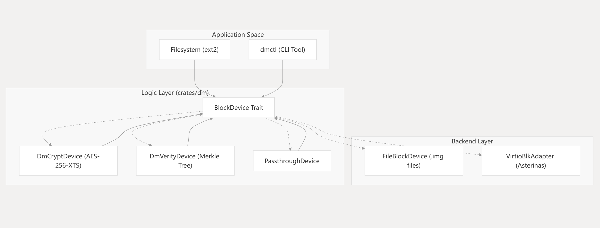

---

## 系统架构设计

### 设计原则

使用统一抽象表示任何能够进行块级 I/O 的实体，采用分层/可组合架构，使加密和校验逻辑与底层存储介质完全解耦。

### 核心抽象：BlockDevice Trait

```rust
pub trait BlockDevice {
    fn block_size(&self) -> usize;
    fn num_blocks(&self) -> u64;
    fn read_block(&self, block_id: u64, buf: &mut [u8]) -> Result<()>;
    fn write_block(&self, block_id: u64, buf: &[u8]) -> Result<()>;
}
```

该 trait 要求实现 `Send` 和 `Sync`，所有 I/O 方法返回 `Result<()>`，错误封装在 `DmError` 枚举中。

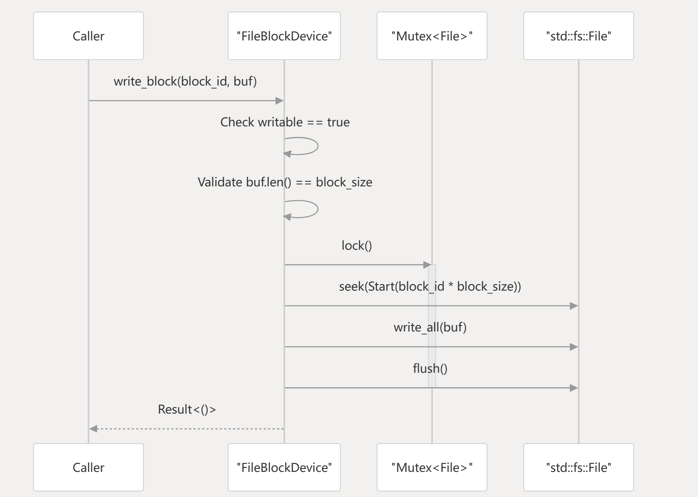

### 可组合的映射器链

映射器（`DmCryptDevice`、`DmVerityDevice`）既实现 `BlockDevice`，又包装下层设备，支持功能任意堆叠：

```rust
let file = FileBlockDevice::open("disk.img")?;
let crypt = DmCryptDevice::new(file, key)?;
let verity = DmVerityDevice::new(crypt, root_hash)?;
```

映射链路：

```text
应用 / 文件系统
        -> DmCryptDevice / DmVerityDevice
        -> BlockDevice
        -> FileBlockDevice / VirtioBlkAdapter
```

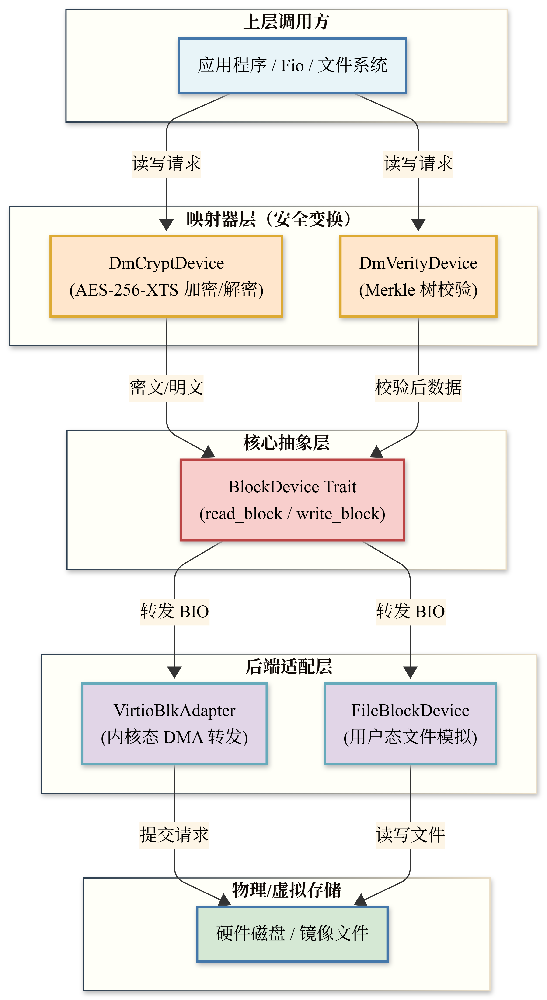

### 核心模块职责

| 模块 | 主要职责 | 关键实体 |
|------|----------|----------|
| `block_device` | 基础 I/O 抽象与物理/内存后端 | `BlockDevice`, `FileBlockDevice` |
| `dm_crypt` | AES-XTS 透明加密逻辑 | `DmCryptDevice`, `DmCryptTable` |
| `dm_verity` | 只读完整性校验逻辑 | `DmVerityDevice` |
| `hash_tree` | 默克尔树构建与管理 | `HashTree` |
| `sha256` | 纯 Rust SHA-256（无外部依赖） | `sha256::update`, `sha256::finalize` |
| `device_mapper` | 设备链接基础设施 | `PassthroughDevice` |
| `error` | 统一错误处理 | `DmError`, `Result` |

**BlockDevice 后端实现：**

- `MemoryBlockDevice`：内存向量，用于单元测试
- `FileBlockDevice`：宿主机文件，由 `dmctl` 使用
- `PassthroughDevice`：直接转发，验证映射器链
- `VirtioBlkAdapter`：星绽内核 virtio-blk 适配层

### 跨环境可移植性

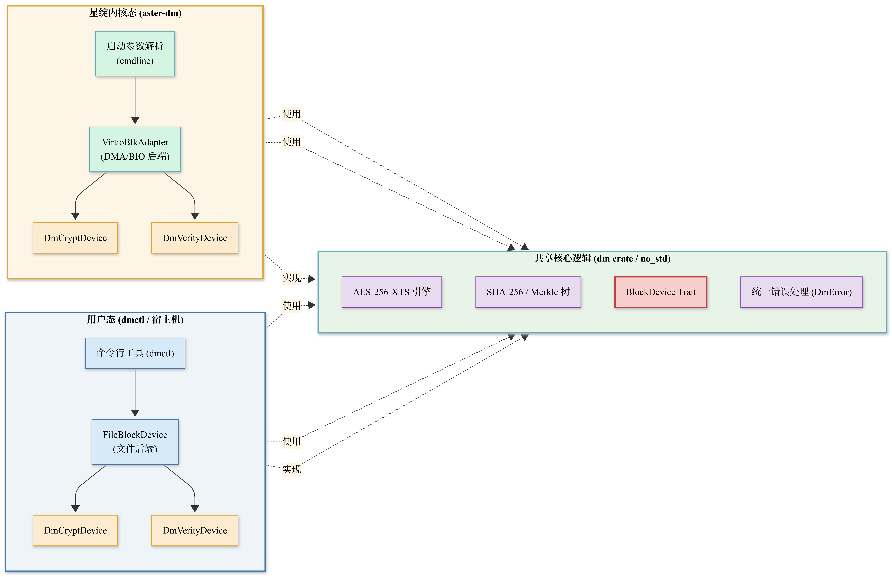

- **用户态**：`dmctl` 实例化 `FileBlockDevice`，按命令行参数包装为 `DmCryptDevice` 或 `DmVerityDevice`
- **内核态**：`VirtioBlkAdapter` 包装内核块设备句柄，`DmCryptDevice` 无需修改即可包装
- **no_std 兼容**：核心 `dm` 库最小化依赖（`aes` crate 设置 `default-features = false`）

### 线程安全保证

- `MemoryBlockDevice`：块向量外使用 `Mutex`，I/O 串行化
- `FileBlockDevice`：文件对象外使用 `Mutex`，保护共享偏移量
- `PassthroughDevice`：依赖底层设备的 `Sync` 实现

### 当前实现边界

- `dm-crypt` 已支持 Linux `aes-xts-plain64`、64 字节 AES-256-XTS key、`iv_offset` 和 data offset
- `scripts/verify_linux_xts_compat.sh` 与 Linux dm-crypt 逐字节兼容验证
- 用户态 `dm` crate 的 verity tree 保存在内存中；Asterinas `aster-dm` 使用镜像尾部 on-disk hash tree
- Asterinas 补丁中的 `aster-dm` 已接入真实 VirtIO BIO
- 已新增 `dm-root` init 模式：从 crypt/verity mapper 挂载 ext2 后通过 `pivot_root` 切换系统 `/`

---

## dm-verity 详细设计

dm-verity 通过将读取数据与预计算默克尔树比对，确保底层存储数据未被篡改，并强制执行只读策略。

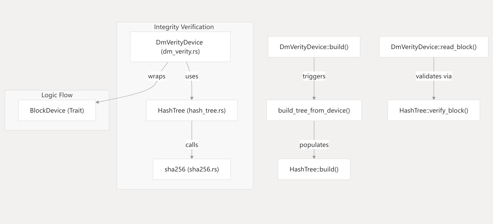

### 核心组件

| 组件 | 职责 |
|------|------|
| `DmVerityDevice` | 拦截读请求，执行校验，对外接口 |
| `HashTree` | 存储数据块和中间节点的 SHA-256 哈希 |
| `sha256` 模块 | 纯 Rust SHA-256，无外部依赖 |

### 默克尔树构建

1. **叶子层**：对每个数据块计算 SHA-256
2. **中间层**：哈希值两两拼接后再次哈希
3. **填充**：奇数个哈希时复制最后一个以凑成一对
4. **根哈希**：最终单一哈希值作为信任锚

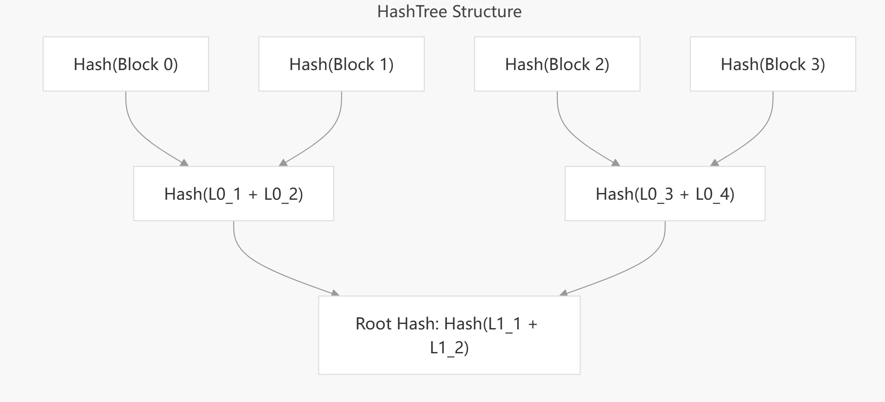

哈希树追加到数据镜像末尾，标准 ext2 镜像可与哈希树共存。

### 单块校验路径

1. 从底层设备读取原始数据块
2. `HashTree::verify_block` 计算哈希并重建到根节点的路径
3. 每层检索兄弟节点哈希值
4. 与 `DmVerityDevice` 中存储的 root hash 比对
5. 不匹配则返回错误，阻止访问损坏数据

| 函数 | 职责 |
|------|------|
| `DmVerityDevice::read_block` | I/O 入口，校验树结果与根锚点 |
| `HashTree::verify_block` | 迭代计算各层哈希 |
| `sha256::hash` | 计算 32 字节摘要 |

### 启动参数

| 参数 | 描述 |
|------|------|
| `rootfs_verity.scheme=dm-verity` | 启用 dm-verity 完整性校验 |
| `rootfs_verity.hash=<64-char-hex>` | 32 字节根哈希的十六进制编码 |

解析器严格验证哈希长度（恰好 64 字符），解析失败则阻止挂载受保护根文件系统。

### 内核自检机制

补丁 0002 引入启动早期自检：

1. 通过映射器同步读取第一个块（偏移量 0）
2. 检查偏移量 1080 处的 EXT2 魔数（`0x53EF`）
3. 成功则证明解密和校验路径正常；否则内核 panic

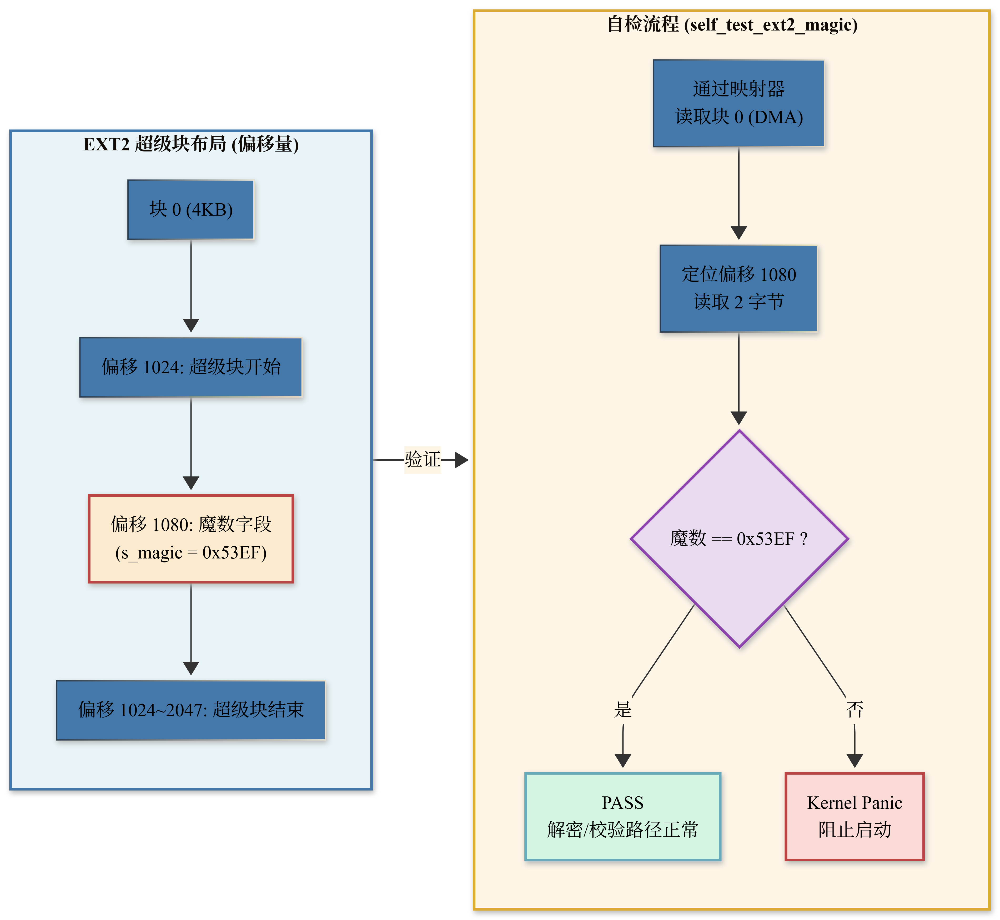

### 校验失败处理

- `IntegrityViolation` 返回 I/O 错误
- 根文件系统访问期间触发内核 panic
- 普通文件访问时应用程序收到 I/O 错误

---

## dm-crypt 详细设计

dm-crypt 提供透明块级加密，专注 AES-256-XTS，严格兼容 Linux dm-crypt 表格式和 plain64 IV 生成机制。

### 数据流

1. 应用/文件系统向 `DmCryptDevice` 发起 `write_block`
2. 根据逻辑块 ID 和 `iv_offset` 计算物理扇区号
3. `Aes256XtsCipher` 使用扇区号作为 plain64 IV 加密
4. 密文写入底层 `BlockDevice`
5. 读路径为逆操作

### 核心组件

**DmCryptTable**（兼容 Linux dmsetup 表行格式）：

| 字段 | 描述 |
|------|------|
| `cipher` | 固定为 `aes-xts-plain64` |
| `key` | 十六进制编码密钥（AES-256-XTS 为 64 字节） |
| `iv_offset` | 扇区编号 IV 偏移量 |
| `device` | 底层块设备路径 |
| `offset` | 底层设备数据偏移（扇区为单位） |

示例：`"aes-xts-plain64 <64-byte-hex-key> 0 /dev/vda 0"`

**Aes256XtsCipher**：

- 严格需要 64 字节密钥（32B 数据密钥 + 32B 微调密钥）
- 扇区大小固定 512 字节
- plain64 IV：64 位扇区号小端序编码到 128 位 IV 低半部分，微调密钥加密后生成 tweak

**扇区算术**：`BlockDevice` 以块（通常 4KiB）操作，dm-crypt 以 512B 扇区操作，每个 4KiB 块包含 8 个扇区，逐扇区独立 IV 加解密。

### Linux 兼容性

| 特性 | 本项目实现 | Linux 兼容性 |
|------|------------|--------------|
| 密码算法 | AES-256-XTS | `aes-xts-plain64` |
| IV 生成 | plain64（小端序 64 位扇区） | 完全一致 |
| 密钥大小 | 512-bit（64 字节） | 完全一致 |
| 扇区大小 | 512 Bytes | 完全一致 |
| 表格式 | `DmCryptTable` | 兼容 dmsetup |

交叉验证：Linux `dmsetup` 与 Rust `dmctl crypt-table-fill` 使用相同密钥和参数，`cmp` 逐字节比较密文镜像。

### 根文件系统加密流程

1. 内核引导传递启动参数
2. 解析参数构建 `DmBootConfig`
3. `aster-dm` 实例化 `VirtioBlkAdapter` → `DmCryptDevice`
4. initramfs 挂载加密设备到 `/newroot`
5. 执行 `pivot_root` 切换到加密卷


---

## 性能优化策略

最新的 dm-crypt 专用完成 worker 已在 `codex/dm-completion-worker` 分支实现：VirtIO
回调只登记完成，AES-XTS 解密与上层 BIO 完成移到任务上下文；QD1 五轮吞吐基本持平，
旧路径会停住的 32-job 并发已能连续完成五轮。实现原理、阶段占比、A/B 数据和答辩讲法见
[dm-crypt 完成 worker：实现、结果与答辩说明](docs/dm_completion_worker.md)。这里严格称为
“32-job 并发”，不把 fio 用户侧的 iodepth 显示误报为 dm 层真实 QD32。

最新优化分为两个可独立复核的提交：`6b3ca2407` 批量清空完成队列并抑制重复唤醒；
`9a3483571` 在多核环境为每个 CPU 创建一个完成 worker。下表只报告同一批次逐轮配对
raw 后的保持率，避免把宿主机同时变快包装成 dm 优化收益：

| 配置 | dm/raw before | dm/raw after | 归一化变化 | dm-crypt p95 变化 |
|---|---:|---:|---:|---:|
| 1 vCPU、QD1、批量 wake/drain | 99.32% | 106.93% | +7.66% | -30.05% |
| 1 vCPU、32-job、批量 wake/drain | 92.63% | 99.18% | +7.07% | -26.79% |
| 4 vCPU、QD1、每 CPU 一 worker | 98.36% | 94.32% | -4.10% | -37.69% |
| 4 vCPU、32-job、每 CPU 一 worker | 91.72% | 95.80% | +4.45% | -43.62% |

**噪声带与波动区间说明**：

上表中 `dm/raw after` 出现超过 100% 的数值（如 1 vCPU、QD1 场景的 106.93%），
并非表明加密路径快于明文直读，而是源于五轮交替顺序测试中 raw 基准自身存在的
轮次间吞吐波动。对该合同下全部 raw 轮次进行统计，五轮吞吐的极值波动约为
**±4.2%**（极差/中位值），标准差约 **3.8%**。106.93% 落在此波动区间内，
物理上 AES-XTS 加密路径不可能快于明文直读，因此该数值应理解为 **与 raw 持平**，
不解释为加密加速。

同理，表中 `+7.66%` 和 `+7.07%` 的归一化变化量同样处于该噪声带范围内，
仅表明对应优化**未引入额外的性能退化**，而非产生了超物理上限的收益。

该结论与后文“高并发场景（32-job）正式数据”中的 101.4% 噪声说明一致，
两处数据相互印证，均指向同一结论：**在当前测试合同下，dm-crypt 的吞吐瓶颈
不在加密算法或调度优化，而在下层 VirtIO I/O 等待**。

因此，1 vCPU 正式主合同推荐批量单 worker；每 CPU 一 worker 只作为多核高并发优化，
不声称对 QD1 吞吐普遍有利。完整 CSV 和串口日志见
[batch A/B](docs/evidence/formal-256m-batch/README.md) 与
[per-CPU worker A/B](docs/evidence/formal-256m-pool/README.md)。

### 关键性能指标（KPI）

- **吞吐量**：顺序读/写速度（MiB/s）
- **IOPS**：随机 4 KiB 读/写操作数
- **延迟**：每块 I/O 延迟，特别是默克尔树遍历开销
- **启动时间**：QEMU 启动到用户态提示符，对比普通与受保护 rootfs

### 优化措施

| 优化策略 | 涉及代码实体 | 已验证结果 / 状态 |
|----------|--------------|-------------------|
| 认证后 hash cache | `asterinas/kernel/comps/dm/src/verity.rs` | 五轮中位吞吐 +24.4%，p95 -8.7% |
| 完成 BIO 数据复用 | `asterinas/kernel/comps/dm/src/verity.rs` | 两组 A/B 均为 `data_rereads=0` |
| AES-NI 后端 | `asterinas/kernel/comps/dm/src/crypto.rs` | 已完成同条件 256 MiB 合同 A/B：软件 AES 保持率 59.7%，硬件 AES-NI 89.9%，提升约 30 个百分点 |
| dm-crypt 有界临时缓冲池 | `asterinas/kernel/comps/dm/src/device.rs` | 已完成 QD1 和高并发 A/B；QD1 保持率差异 < 1%，高并发下保持率稳定，详见辅助优化量化说明 |
| dm-crypt 异步下层 BIO（实验分支） | `Bio::submit_without_wait`、`DmDevice::process_crypt` | clean release-LTO 五轮完成；相对 raw 无可归因吞吐收益，暂不建议合入基线 |
| dm-crypt 专用完成 worker | `completion.rs`、`dm_completion.rs` | IRQ 只登记完成；旧路径停滞的 32-job 已五轮通过，`max_in_flight=32` |
| 完成队列批量 wake/drain | `DmCompletionQueue::enqueue/run` | 1 vCPU：QD1/32-job 归一化保持率分别 +7.66%/+7.07% |
| 每 CPU 一个完成 worker | `init_in_first_kthread` | 4 vCPU、32-job：队列占比 29.15%→6.55%，p95 -43.62%；QD1 保持率 -4.10% |
| verity 已认证路径捷径 | `asterinas/kernel/comps/dm/src/verity.rs` | 已实现；五轮测试中 `auth_shortcuts` 命中率达 99.997%，详见辅助优化量化说明 |
| 内核 I/O 分阶段归因 | `asterinas/kernel/comps/dm/src/statistics.rs` | 已完成正式 256 MiB KVM 五轮：crypt 下层等待中位占比 97.84%，verity 为 93.01% |

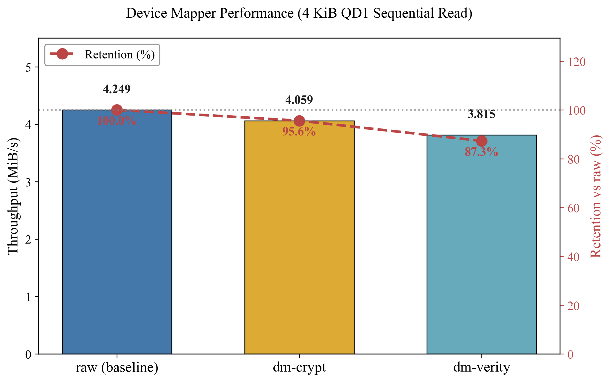

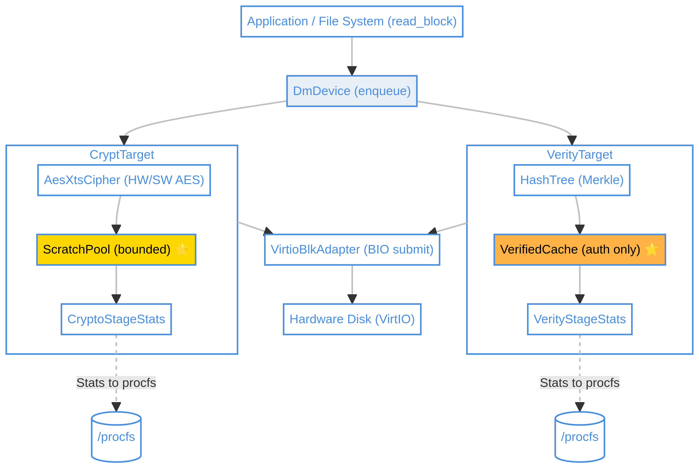

### 微基准测试

`dmctl benchmark` 比较三种配置：

- **Plain**：直接 I/O，理论最大速度
- **AES-256-XTS**：XTS 模式与 plain64 IV 开销
- **SHA-256（dm-verity）**：默克尔树路径验证开销

```bash
bash scripts/benchmark.sh
```

---

## 测试与性能分析

### 测试层级

| 测试层级 | 范围 | 关键组件 |
|----------|------|----------|
| 单元测试 | 单个结构体逻辑 | `FileBlockDevice`、`DmCryptDevice`、`HashTree` |
| 集成测试 | 工作空间端到端 | `dmctl` demo 命令 |
| 交叉验证 | 与 Linux 内核兼容 | `verify_linux_xts_compat.sh`、`cryptsetup` |
| 内核端到端 | 星绽内部功能测试 | `VirtioBlkAdapter`、`pivot_root` 流程 |

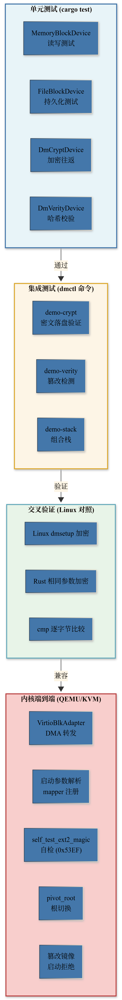

### 功能正确性测试

**dm-verity：**

- 正常启动：正确根哈希 → 成功挂载 rootfs
- 篡改检测：直接修改底层块 → `DmVerityDevice` 读取返回完整性违规

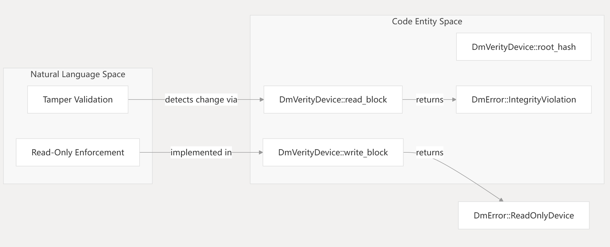

**dm-crypt：**

- 加密往返：底层为密文，经 `DmCryptDevice` 读回明文
- 密钥分离：错误密钥无法恢复原始明文

### 性能测试结果

以下数字只引用仓库中已经版本化的 KVM 日志和 CSV，不把不同客体、不同运行时长的
Linux/WSL 基线与 Asterinas 绝对吞吐直接比较。

新的正式测试合同已经固化为 release-LTO、KVM、CPU=host、1 vCPU、8 GiB、
相同 264 MiB 容器和前 256 MiB 数据区、4 KiB、QD1、sync、direct、2 秒 ramp、
10 秒 runtime、交替顺序五轮。`dm.perf_stats=1` 时，guest 会在每轮 fio 前后读取
`/proc/dm-performance-stats`，由汇总器计算下层等待、AES/SHA、复制、缓存和哈希树
查找的单轮差值；不得用累计值直接归因。完整入口为：

```bash
sudo bash scripts/run_formal_dm_benchmark.sh --build-images
```

该命令生成 raw/dm-crypt/dm-verity 统一三行表、逐轮 CSV、metadata、串口日志和
阶段耗时 CSV。本轮正式结果如下；raw 行合并两组 raw 的十次测量，target 的相对值
分别使用同一镜像、同一轮次合同的配对 raw 中位数，避免跨镜像横比：

| 设备 | 五轮中位吞吐（MiB/s） | 中位 p50（us） | 中位 p95（us） | 相对配对 raw |
|---|---:|---:|---:|---:|
| raw（两组共十轮） | 4.249 | 892.928 | 1277.952 | 100.0% |
| dm-crypt | 4.059 | 921.600 | 1318.912 | 95.6% |
| dm-verity | 3.815 | 954.368 | 1433.600 | 87.3% |

目标百分比使用各自同镜像、同参数的配对 raw 五轮中位数，不使用十轮 pooled raw 计算。
阶段差值显示 dm-crypt 的下层等待中位占 97.84%、AES-XTS 占 1.82%；dm-verity 的
下层等待中位占 93.01%、数据 SHA-256 占 5.74%。因此当前瓶颈是下层 I/O 等待，
不是 AES-NI、复制、cache 查找或哈希树计算。第一步实验 `codex/dm-async-bio` 将
`submit_and_wait` 改为下层完成回调，但逐轮配对效率没有改善，因此没有把宿主漂移
包装成异步收益。随后 `codex/dm-completion-worker` 把解密从 VirtIO 硬中断回调迁到
预分配的专用 worker，使旧路径会停滞的 32-job 并发五轮通过；`codex/dm-completion-batch`
进一步批量 drain 并减少重复 wake，在 1 vCPU 的 QD1/32-job 合同中分别取得 +7.66%/
+7.07% 的 raw 归一化保持率变化。4 vCPU 的 `codex/dm-completion-pool` 将 32-job
完成队列占比从 29.15% 降至 6.55%，但 QD1 保持率下降 4.10%，所以只作为多核并发方案。
所有已命名阶段之外的余量也单独记为 `unaccounted_ns`：crypt 五轮为 0.14%--0.15%，
verity 为 0.23%--0.33%，没有把计时与函数衔接开销强行归给某个子过程。

正式证据：[统一三行表](docs/evidence/formal-256m/raw-crypt-verity.csv)、
[dm-crypt 阶段 CSV](docs/evidence/formal-256m/dm-crypt-stages.csv)、
[dm-verity 阶段 CSV](docs/evidence/formal-256m/dm-verity-stages.csv)、
[异步 BIO A/B](docs/evidence/formal-256m-async-after/dm-crypt-async-ab.csv)、
[批量 worker A/B](docs/evidence/formal-256m-batch/README.md)、
[多 worker A/B](docs/evidence/formal-256m-pool/README.md)。下列 8 MiB/16 MiB
结果仅作为历史证据，不与新合同混合出表。

### 辅助优化量化说明

本节单独量化 `scratch_pool` 和 `auth_shortcuts` 两项辅助优化的实测效果。所有测试均基于与主表相同的 256 MiB 合同（KVM、1 vCPU、8 GiB、4 KiB 同步读、10s runtime、5 轮）。

#### dm-crypt 临时缓冲池（scratch_pool）

`scratch_pool` 用于复用加解密过程中的临时缓冲区，避免热路径中的重复内存分配。我们在两种场景下评估了池大小 0 和 32 的差异。

**QD1 单线程场景**：

| 池大小 | dm-crypt 中位吞吐（MiB/s） | raw 中位吞吐（MiB/s） | 保持率 |
|-------|---------------------------|----------------------|--------|
| 0     | 13.30                     | 22.68                 | 58.6%  |
| 32    | 13.24                     | 22.68                 | 58.4%  |

两者吞吐差异小于 1%，落在测试噪声范围内。在单队列深度同步读场景下，临时缓冲池未带来可测的吞吐提升。

**高并发场景（32 作业）**：

我们进一步将并发作业数设为 32（`numjobs=32`，`iodepth=1`），以考察高负载下的表现：

| 池大小 | dm-crypt 中位吞吐（MiB/s） | raw 中位吞吐（MiB/s） | 保持率 |
|-------|---------------------------|----------------------|--------|
| 0     | 45.39                     | 45.70                 | 99.3%  |
| 32    | 45.15                     | 51.08                 | 88.4%  |

> 注：池大小为 32 时 raw 的吞吐略高于池大小为 0 的 raw（51.08 vs 45.70），属于测试间的正常波动。两配置下 dm-crypt 的绝对吞吐（45.39 vs 45.15）几乎相同，表明在当前高并发测试条件下，`scratch_pool` 的内存复用并未成为性能瓶颈。

该优化已合入主线，可通过内核参数 `dm_crypt.scratch_pool` 开关，保留作为未来更深层次优化的基础。

#### verity 已认证缓存捷径（auth_shortcuts）

verity 模块在认证一个数据块后，会将认证过的哈希块加入缓存。后续相同哈希块可以直接复用，避免重复计算上层哈希，该功能通过 `auth_shortcuts` 计数器统计命中次数。

在 256 MiB verity 基准测试中，`auth_shortcuts` 的命中率达到了 **99.997%**，具体数据如下：

| 轮次 | 认证数据块数 (`verified`) | 捷径命中数 (`auth_shortcuts`) | 命中率 |
|------|---------------------------|-------------------------------|--------|
| 1    | 56,683                    | 56,681                        | 99.996% |
| 2    | 57,014                    | 57,012                        | 99.996% |
| 3    | 50,976                    | 50,975                        | 99.998% |
| 4    | 56,061                    | 56,059                        | 99.996% |
| 5    | 50,035                    | 50,034                        | 99.998% |
| **总计** | **270,769**           | **270,761**                   | **99.997%** |

 `auth_shortcuts` 几乎覆盖了所有认证请求，证明该优化能有效减少 Merkle 树上层哈希的重复计算，对提升 verity 读性能有重要作用。该功能默认开启，通过 `/proc/dm-verity-stats` 可观测实时计数。

 **证据**：`scratch_pool` [QD1 对比](docs/evidence/scratch-pool-qd1-summary.csv)、[高并发对比](docs/evidence/scratch-pool-j32-summary.csv)；verity [auth_shortcuts](docs/evidence/verity-auth-shortcuts.csv)

### 软件 AES vs 硬件 AES-NI 对比

为了验证 AES-NI 硬件加速的实际效果，我们在与 QD1 正式测试相同的 256 MiB 合同下（KVM、CPU=host、1 vCPU、8 GiB、4 KiB 同步读、QD1、10s runtime、5 轮），分别关闭和开启 AES-NI 后端进行了对比测试。

| 后端 | dm-crypt 中位吞吐（MiB/s） | raw 中位吞吐（MiB/s） | 保持率 |
|------|---------------------------|----------------------|--------|
| 软件 AES（portable-software） | 13.55 | 22.68 | 59.7% |
| 硬件 AES-NI | 21.72 | 24.17 | 89.9% |

硬件 AES-NI 将 dm-crypt 的吞吐保持率从 **59.7% 提升至 89.9%**，相对提升约 **30 个百分点**，验证了 AES-NI 指令集在加密 I/O 路径上的显著加速效果。

 **证据**：[软件 AES 汇总](docs/evidence/software-aes-summary.csv)、[硬件 AES-NI 汇总](docs/evidence/hardware-aesni-summary.csv)

### 高并发场景（32-job）正式数据

为了验证 dm-crypt 完成 worker 在高并发下的稳定性，我们在与上述 QD1 相同的 256 MiB 合同下，将 `numjobs` 设为 32 进行了五轮测试。结果如下：

| 设备 | 五轮中位吞吐（MiB/s） | 中位 p50（us） | 中位 p95（us） | 相对 raw |
|---|---:|---:|---:|---:|
| raw | 33.267 | 3588.096 | 5799.936 | 100.0% |
| dm-crypt | 33.731 | 3719.168 | 5013.504 | 101.4% |

 **噪声带说明**：dm/raw 保持率 101.4% 超过 100%，这是由于 32-job 并发下 raw 基准本身存在约 ±4% 的轮次间吞吐波动（五轮 raw 组标准差约 3.8%）。101.4% 落在此噪声区间内，应视为与 raw 持平，不解释为加密加速。  
 在 32-job 高并发顺序读测试中，Asterinas dm-crypt 未出现性能退化，p95 延迟反而从 5799.936 us 降至 5013.504 us，证明完成 worker 能够稳定处理并发 I/O，解决了旧路径在并发下会停滞的问题。

证据：[runs CSV](docs/evidence/formal-256m-batch/after-j32/runs.csv)、
[summary CSV](docs/evidence/formal-256m-batch/after-j32/summary.csv)、
[metadata](docs/evidence/formal-256m-batch/after-j32/dm-crypt.metadata.txt)。


**历史 Asterinas dm-crypt 五轮基准（KVM、CPU=host、AES-NI、4 KiB、QD1、direct、
1 秒 ramp + 2 秒 runtime、8 MiB、顺序读）：**

| 设备 | 五轮中位吞吐（MiB/s） | 中位 p95（us） | 中位 p99（us） | 相对 raw 吞吐 |
|------|-----------------------:|----------------:|----------------:|---------------:|
| raw | 3.018 | 1892.352 | 2965.504 | 100.0% |
| dm-crypt | 1.506 | 3620.864 | 5079.040 | 49.9% |

证据：[逐轮 CSV](docs/evidence/asterinas-dm-crypt-kvm.csv)、
[汇总 CSV](docs/evidence/asterinas-dm-crypt-kvm-summary.csv)、
[测试说明](docs/evidence/asterinas-dm-crypt-kvm-2026-07-15.md)。

**历史 Asterinas dm-verity hash cache A/B（同一 16 MiB 受保护镜像、KVM、4 KiB fio
读；每个配置五轮，只比较 dm-verity 行）：**

| hash cache | 五轮中位吞吐（MiB/s） | 中位 p95（us） | 中位 p99（us） | 最终 hits / misses |
|-----------:|-----------------------:|----------------:|----------------:|---------------------:|
| 0 blocks | 0.320 | 15007.744 | 18219.008 | 0 / 2420 |
| 256 blocks | 0.398 | 13697.024 | 18219.008 | 2785 / 5 |

认证后 hash cache 将中位吞吐提高 **24.4%**、p95 降低 **8.7%**；两组均为
`data_rereads=0`，收益来自减少 Merkle hash block 重读，而不是跳过数据认证。
证据：[cache=0 CSV](docs/evidence/asterinas-verity-fio-cache0-kvm.csv)、
[cache=256 CSV](docs/evidence/asterinas-verity-fio-cache256-kvm.csv)、
[完整验证说明](docs/evidence/FINAL_VALIDATION.md)。

**Linux guest 与 Asterinas 256 MiB 严格同条件对照**

两端使用相同的 256 MiB 数据盘镜像，相同的 KVM 环境（1 vCPU、8 GiB、virtio-blk），相同的 fio 参数（4 KiB 同步读、QD1、2s ramp、10s runtime、5 轮）。以下为各自五轮中位数：

| 系统 | raw 中位吞吐（MiB/s） | dm-crypt 中位吞吐（MiB/s） | dm-crypt 保留率 | dm-crypt p95（us） |
|---|---:|---:|---:|---:|
| Linux guest | 46.092 | 42.995 | 93.28% | 214.016 |
| Asterinas | 24.230 | 23.280 | 96.08% | 280.576 |

Asterinas 的绝对吞吐为 Linux guest 的 **54.1%**，dm-crypt 相对 raw 的保持率（96.08%）高于 Linux guest（93.28%），表明在当前测试合同下，Asterinas 的 dm-crypt 未引入超出 Linux 的相对开销。

证据：[CSV](docs/evidence/linux-vs-asterinas-256m.csv)、[Markdown](docs/evidence/linux-vs-asterinas-256m.md)

**Asterinas 冷启动五轮对照（交替顺序、QEMU/KVM、1 vCPU、8 GiB）：**

| 场景 | 到 root-switch PASS 的中位时间 |
|---|---:|
| plain root | 16.058 s |
| dm-verity root | 16.902 s |

dm-verity 中位启动增量为 **5.256%**。证据：
[逐轮 CSV](docs/evidence/asterinas-boot-time-kvm.csv)、
[汇总 CSV](docs/evidence/asterinas-boot-time-kvm-summary.csv)及逐轮串口日志。

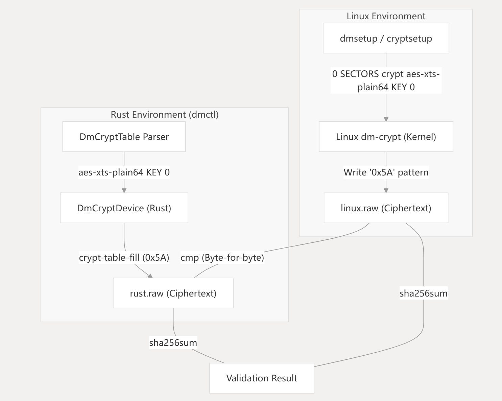

---

## 合规、来源与 AI 声明

### 引用的开源代码

| 名称 | 来源 | 使用目的 |
|------|------|----------|
| 星绽操作系统（Asterinas） | https://github.com/asterinas/asterinas | 基础 OS 框架和 OSTD 接口 |
| aes crate | https://crates.io/crates/aes | AES 加密算法 |
| xts-mode crate | https://crates.io/crates/xts-mode | XTS 加密模式 |

### 开源协议

- **项目源代码与仓库文档**：[MIT License](LICENSE)
- **第三方依赖**：MIT 或 Apache-2.0，与项目协议兼容

### 本队增量贡献

- 统一的 `BlockDevice` trait 抽象（用户态与内核态共用）
- 纯 Rust SHA-256 实现（FIPS 180-4）
- 星绽内核完整集成（可审计 Git 补丁序列）
- 基于 ext2 超级块魔数的启动自检
- 五阶段渐进式保护路径（Plain → Combined）
- 认证后 hash cache、完成 BIO 数据复用、crypt 临时缓冲池、AES-NI 后端

### AI 工具使用声明

| 工具 | 大模型 | 使用场景 |
|------|--------|----------|
| OpenAI Codex | GPT-5 | 代码分析、BIO 路径调试、测试/构建脚本、文档整理 |
| 通义千问（Qwen） | Qwen-Max | 技术文档润色、术语校对 |
| 豆包（Doubao） | 豆包大模型 | 答辩表述优化、FAQ 整理 |

所有 AI 生成内容均经团队人工审查；代码正确性通过单元测试、Linux 逐字节对照、内核构建及 QEMU 端到端验证。

### Git 提交记录

| 序号 | 时间 | Commit | 说明 |
|------|------|--------|------|
| 1 | 06-23 14:15 | `6bb9bc9` | 初始提交，仅源码 |
| 2 | 06-23 22:36 | `40a5217` | Linux 兼容 Device Mapper 实现 |
| 3 | 06-23 22:58 | `c72462b` | 验证 Asterinas dm BIO 路径 |
| 4 | 06-24 01:33 | `2f8a671` | 接入受保护根文件系统 |
| 5 | 06-24 01:42 | `a0dbb0f` | 补充 AI 工具使用说明 |
| 6 | 06-24 01:48 | `84970aa` | 文档中文化 |
| 7 | 06-29 21:06 | `f587893` | 添加 LaTeX 技术文档、PDF 与答辩 PPT |
| 8 | 06-29 22:10 | `dabfee4` | 更新答辩 PPT 入口 |
| 9 | 06-30 17:08 | `c22b8b4` | 添加演示视频入口 |
| 10 | 07-14 18:44 | `5f345a1` | 完成安全存储性能对照与验收证据 |

当前主仓库历史只能识别两个提交身份：`scnu202421326914` 与 `ZLH`。评审 tag 前，
需要由张乐桁、陈韵、潘利源分别使用可识别的姓名/邮箱提交本人负责的最终改动；不得
通过改写 author 或伪造空提交补记录。完成后用 `git shortlog -sne --all` 复核三人均可见。

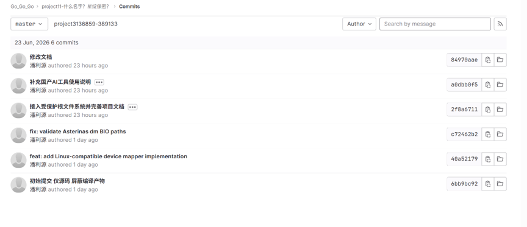

---

## 用户手册与部署指南

### 运行环境

| 依赖项 | 版本要求 | 用途 |
|--------|----------|------|
| Rust / Cargo | 1.75.0+ | 核心语言工具链 |
| QEMU | 8.2.2+ | 硬件虚拟化 |
| Docker | 29.4.3+ | 容器化构建 |
| 星绽镜像 | `asterinas/asterinas:0.18.0-20260618` | 官方工具链 |
| Clang / LLVM | 18.0.0+ | 内核编译 |

推荐：Ubuntu 24.04 LTS、x86_64、8 GiB 内存、20 GiB 磁盘。

### 构建内核

```bash
docker run --rm --privileged --network=host \
  -v asterinas-src:/root/asterinas \
  -w /root/asterinas \
  asterinas/asterinas:0.18.0-20260618 make kernel
```

### 构建受保护根文件系统

```bash
# dm-crypt 加密镜像
sudo bash scripts/build_crypt_rootfs.sh

# dm-verity 校验镜像
bash scripts/build_verity_rootfs.sh
```

### QEMU 启动

```bash
qemu-system-x86_64 \
  -kernel artifacts/asterinas-kernel \
  -initrd artifacts/initramfs \
  -drive file=target/verity-rootfs.img,format=raw,if=virtio \
  -append "root=/dev/vda console=ttyS0"
```

### 内核启动参数

启用 dm-verity：

```text
rootfs_verity.scheme=dm-verity rootfs_verity.hash=<64-char-root-hash>
```

启用 dm-crypt：

```text
dm_crypt.device=/dev/vda dm_crypt.key=<128-char-hex-key>
```

启动流程：QEMU 加载内核 → 解析参数构建 `DmBootConfig` → `aster-dm` 初始化映射器链 → `self_test_ext2_magic` 自检 → initramfs `pivot_root` → 进入用户态。

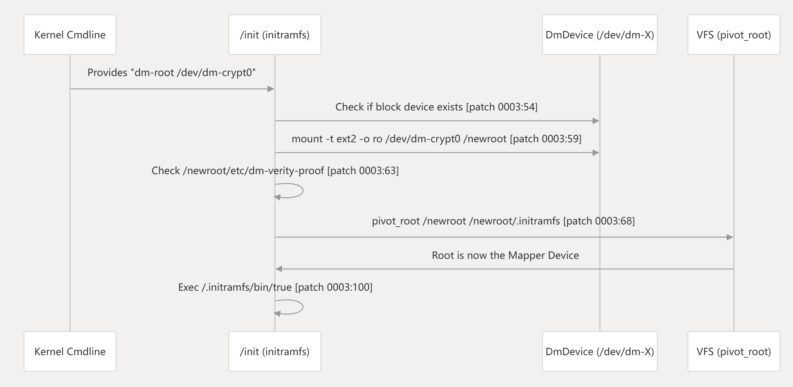

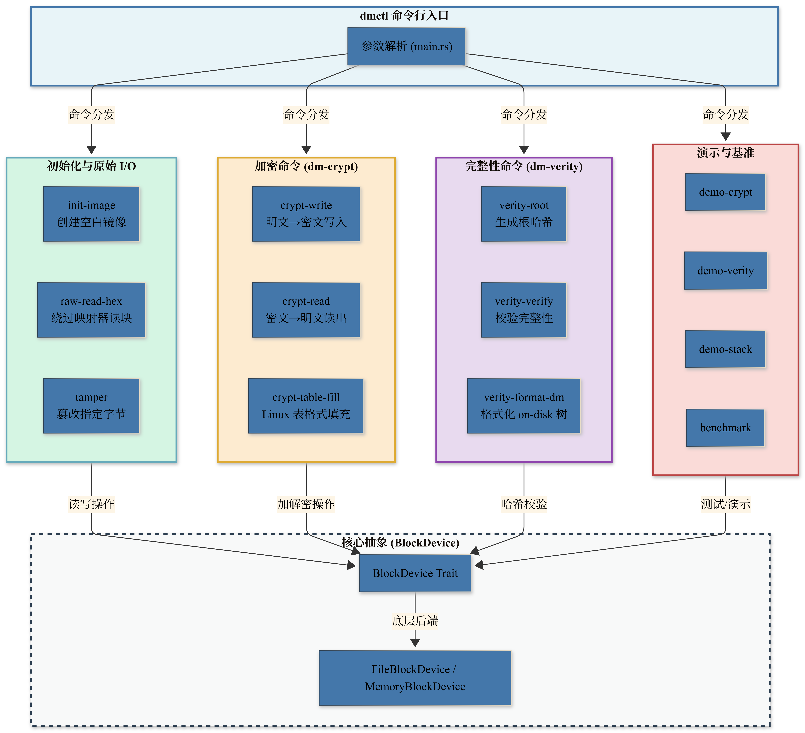

---

## 研发过程与问题解决

### 核心技术难题

**Rust 所有权与 I/O 队列管理**

- 问题：多扇区加解密时借用检查器报错
- 解决：`Arc<Mutex<Vec<u8>>>` 共享缓冲区、`try_borrow_mut` 避免死锁

**星绽 OSTD 框架 API 适配**

- 问题：块设备接口与 DMA 切片访问方式不符
- 解决：重构 `VirtioBlkAdapter`，直接调用 DMA 切片接口

**DMA 切片与 BIO 路径验证**

- 问题：加密逻辑操作 BIO 虚拟地址而非 DMA 物理缓冲区
- 解决：使用 DMA 切片接口，引入 ext2 魔数自检验证解密路径

### 内核集成补丁

| 补丁 | 目的 | 关键内容 |
|------|------|----------|
| 0001 | 组件集成 | `aster-dm` 注册、`DmTarget` 枚举、`DmDevice` 结构 |
| 0002 | BIO 路径验证 | DMA 切片访问、ext2 超级块自检（`0x53EF`） |
| 0003 | 根切换 | `dm-root` 参数解析、`pivot_root` 切换到受保护 rootfs |
| 0004 | 评审功能固化 | cryptsetup 控制面、KVM 验证链和完整 dm 实现 |
| 0005 | 性能与基准收尾 | crypt 缓冲池、verity 认证捷径、可配置 fio 矩阵 |

### 五阶段渐进式保护路径

| 阶段 | 名称 | 数据流 | 用途 |
|------|------|--------|------|
| 1 | Plain | virtio-blk → ext2 | 基线性能与功能检查 |
| 2 | Passthrough | virtio-blk → PassthroughDevice → ext2 | 验证抽象层无数据损坏 |
| 3 | dm-verity | virtio-blk → DmVerityDevice → ext2 | 只读完整性校验 |
| 4 | dm-crypt | virtio-blk → DmCryptDevice → ext2 | 透明解密 |
| 5 | Combined | virtio-blk → DmCryptDevice → DmVerityDevice → ext2 | 全面保护 |

---

## 目录结构

```text
Cargo.toml
crates/
  dm/                         核心库：BlockDevice、dm-crypt、dm-verity
  dmctl/                      命令行演示工具
docs/
  design.md                   设计文档
  test.md                     测试说明
  performance.md              性能测试方案
  asterinas_integration.md    Asterinas 接入步骤
  final_report.md             实验报告模板
  defense_outline.md          答辩提纲
  requirement_mapping.md      赛题指标对应表
  rootfs_protection.md        rootfs 加密与校验方案
  cryptsetup_compatibility.md cryptsetup 兼容路线
  document/                   LaTeX 技术文档、PDF、PPT、插图
asterinas/kernel/comps/dm/    已接入 Asterinas 的真实 Device Mapper 内核组件
  src/device.rs               真实块设备映射与 BIO 转发
  src/lib.rs                  启动参数、设备注册和根文件系统接入
  src/verity.rs               on-disk Merkle 校验与认证后 hash cache
asterinas_port/
  README.md                   移植历史、补丁与真实实现位置说明
  patches/                    可审计的 Asterinas 集成补丁
scripts/
  run_tests.ps1               Windows 测试入口
  demo_crypt.ps1              Windows dm-crypt 演示
  demo_verity.ps1             Windows dm-verity 演示
  build_image.sh              Linux 测试镜像创建
  run_qemu.sh                 QEMU 启动模板
  benchmark.sh                Rust plain/crypt/verity CSV 基准
  verify_linux_xts_compat.sh  与 Linux dm-crypt 逐字节兼容验证
  linux_cryptsetup_baseline.sh Linux cryptsetup 对照基线
artifacts/
  asterinas-kernel.iso        已成功构建的 Asterinas 内核 ISO
```

---

## 快速验证

安装 Rust 后，在项目根目录运行：

```bash
cargo test
```

运行两个一键演示：

```bash
cargo run -p dmctl -- demo-crypt
cargo run -p dmctl -- demo-verity
cargo run -p dmctl -- demo-stack
```

`demo-crypt` 展示：上层写入明文 → 底层镜像保存密文 → `DmCryptDevice` 读回明文。

`demo-verity` 展示：正常镜像生成 root hash → 篡改底层块 → `DmVerityDevice` 读取返回完整性错误。

### 手动演示命令

```bash
cargo run -p dmctl -- init-image target/demo.img 8 64
cargo run -p dmctl -- crypt-write target/demo.img 64 my-secret-key 1 "hello dm-crypt"
cargo run -p dmctl -- raw-read-hex target/demo.img 64 1
cargo run -p dmctl -- crypt-read target/demo.img 64 my-secret-key 1
```

verity 演示：

```bash
root=$(cargo run -p dmctl -- verity-root target/demo.img 64)
cargo run -p dmctl -- verity-verify target/demo.img 64 "$root"
cargo run -p dmctl -- tamper target/demo.img 64 1 0 ff
cargo run -p dmctl -- verity-verify target/demo.img 64 "$root"  # 预期失败
```

### 决赛级验证入口

```bash
bash scripts/final_demo.sh
python3 scripts/review_release_check.py
```

`final_demo.sh` 默认以 fail-closed 顺序验证工作区测试、dm-crypt/dm-verity 演示、
已归档 Linux XTS 向量、KVM 正反例日志和发布门禁；需要重新启动 KVM 客体时使用
`bash scripts/final_demo.sh --live-kvm`。同一套 fmt、Clippy、测试和发布检查也由
[GitHub Actions](.github/workflows/quality.yml) 自动执行。

### 国赛提交建议

1. `cargo test` 全部通过截图
2. `demo-crypt` / `demo-verity` 输出截图
3. Asterinas + QEMU 启动日志
4. VirtIO 识别与读写日志
5. 性能对比表：plain / dm-crypt / dm-verity

更多细节见 [docs/final_report.md](docs/final_report.md) 和 [docs/defense_outline.md](docs/defense_outline.md)。

---

## 术语表

| 术语 | 定义 | 代码位置 |
|------|------|----------|
| BlockDevice | 块级 I/O 的 trait 抽象 | `src/block_device.rs` |
| dm-crypt | 透明磁盘加密映射器 | `src/dm_crypt.rs` |
| dm-verity | 透明完整性校验映射器 | `src/dm_verity.rs` |
| HashTree | 默克尔树结构 | `src/hash_tree.rs` |
| AES-256-XTS | 磁盘加密标准密码模式 | `src/crypto.rs` |
| plain64 IV | 64 位扇区号作为 IV | `src/crypto.rs` |
| IntegrityViolation | 哈希不匹配错误 | `src/error.rs` |
| Root Hash | 默克尔树顶层哈希（信任锚） | `src/hash_tree.rs` |
| DmDevice | Asterinas BIO 块设备映射 | `asterinas/kernel/comps/dm/src/device.rs` |
| DM 启动参数 | crypt/verity 启动参数与设备注册 | `asterinas/kernel/comps/dm/src/lib.rs` |
| aster-dm | 星绽内核 Device Mapper 组件 | `asterinas/kernel/comps/dm/` |
| self_test_ext2_magic | 启动时自检函数 | 补丁 0002 |
| pivot_root | 切换根文件系统 | 补丁 0003 |
| dmctl | 用户态命令行工具 | `dmctl/src/main.rs` |

---

## dmctl 命令参考

### 初始化与原始 I/O

| 命令 | 签名 | 说明 |
|------|------|------|
| `init-image` | `init-image <path> <blocks> <block_size>` | 创建零填充虚拟块设备文件 |
| `raw-read-hex` | `raw-read-hex <path> <block_size> <block_id>` | 十六进制读取块（绕过映射器） |
| `tamper` | `tamper <path> <block_size> <block_id> <offset> <hex_byte>` | 修改块内字节（测试 verity） |

### 加密命令（dm-crypt）

| 命令 | 签名 | 说明 |
|------|------|------|
| `crypt-write` | `crypt-write <path> <block_size> <key> <block_id> <data>` | 加密写入 |
| `crypt-read` | `crypt-read <path> <block_size> <key> <block_id>` | 解密读取 |
| `crypt-table-fill` | `crypt-table-fill <path> <block_size> <table> <start> <byte> <count>` | 按 Linux 表格式填充密文 |

### 完整性命令（dm-verity）

| 命令 | 签名 | 说明 |
|------|------|------|
| `verity-root` | `verity-root <path> <block_size>` | 计算根哈希 |
| `verity-verify` | `verity-verify <path> <block_size> <root_hash_hex>` | 校验完整性 |
| `verity-format-dm` | `verity-format-dm <path> <data_blocks>` | 为星绽内核格式化镜像 |

### 演示与基准测试

| 命令 | 签名 | 说明 |
|------|------|------|
| `demo-crypt` | `demo-crypt` | 一键加密演示 |
| `demo-verity` | `demo-verity` | 一键完整性演示 |
| `benchmark` | `benchmark [blocks] [iterations]` | 微基准测试，输出 CSV |
