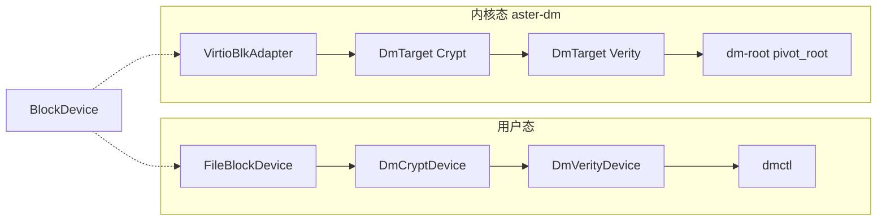

# 星绽操作系统 dm-crypt / dm-verity

全国大学生计算机系统能力大赛操作系统设计赛功能挑战项目。项目在 Asterinas 上实现块级透明加密、只读完整性校验和 `dm-crypt → dm-verity` 组合保护链路，同时提供用户态参考实现、可复现测试脚本与原始证据。

| 项目 | 信息 |
|---|---|
| 队伍 | Go_Go_Go |
| 学校 | 华南师范大学 |
| 成员 | 张乐桁、陈韵、潘利源 |
| 讲解视频 | [百度网盘：星绽守卫讲解视频](https://pan.baidu.com/s/1ol7pTZAZyqmYsqUcwRPung?pwd=oscp)，提取码 `oscp` |
| 演示视频 | [作品演示视频.mp4](作品演示视频.mp4) |
| 进展汇报 | [作品进展汇报幻灯片.pptx](作品进展汇报幻灯片.pptx) |
| 技术文档 | [实现说明](docs/document/main.pdf) · [设计赛道](docs/design_doc/design_doc.pdf) · [实现源码](docs/document/) · [设计赛道源码](docs/design_doc/) · [答辩 PPT](presentation_project.pptx) |

机密计算 Guest 里内存可受 TEE 保护，rootfs 仍落在宿主机不可信介质上，面临明文可读、离线篡改和整盘替换。Linux 用 Device Mapper 的 `dm-crypt` / `dm-verity` 补机密性与完整性；官方星绽的块设备栈没有等价能力，BIO、设备注册和启动流程也与 Linux 不同，不能直接移植 C 实现。本项目用 Rust 补这一层，算法与 Linux `aes-xts-plain64`、SHA-256 Merkle 布局对齐，并同时落到用户态工具和 Asterinas 内核。实现架构、算法、测试、合规与用户手册见 [技术文档](docs/document/main.pdf)；题目分析、开发计划、问题与分工见 [设计赛道文档](docs/design_doc/design_doc.pdf)。两份 PDF 互为补充。

## 完成内容

- `dm-crypt`：AES-256-XTS、`aes-xts-plain64`、64 字节密钥、可配置 IV/数据偏移；用户态走文件镜像，内核态走真实 VirtIO BIO 读写。
- `dm-verity`：SHA-256 磁盘哈希树、按需校验、只读映射、损坏拒绝；内核态支持启动参数注入 root hash 和受保护 rootfs。
- 组合栈：用户态 `demo-stack` 与内核态 `virtio-blk → dm-crypt → dm-verity → ext2` + `pivot_root` 对应。
- 用户态工具 `dmctl`：镜像初始化、加密读写、verity 格式化/校验、篡改、单层与组合演示。
- Asterinas 内核 `aster-dm`：mapper 注册、启动参数、initramfs、自检、`/dev/mapper/control`、挂载与 `pivot_root`。
- 验证：用户态 `cargo test` 与 Linux XTS 逐字节比对；内核态 kernel build、R01–R03、C01–C05、V01–V07、FIO、Filebench、SQLite 和启动耗时。

详细需求对应见 [需求映射](docs/requirement_mapping.md)，正确性结论见 [KVM 正确性报告](KVM_CORRECTNESS_REPORT.md)，性能原始表见 [PERFORMANCE_MATRIX.csv](docs/evidence/final-performance-20260811/PERFORMANCE_MATRIX.csv)。

## 用户态与内核态

同一套 `BlockDevice` 映射逻辑，两处落地。先在用户态把 AES-XTS、Merkle 树和叠栈跑通，再打进 Asterinas 走真实 VirtIO BIO。不是两套互不相干的实现：用户态是算法与布局的安全网，内核态才是赛题交付物。用户态约 3000 行（`crates/dm`）+ `dmctl` 约 800 行；内核补丁 0001–0007 约 4000 行。

**用户态**（`crates/dm` + `dmctl`）不依赖内核。`FileBlockDevice` / `MemoryBlockDevice` 当后端，外面再包 `DmCryptDevice`、`DmVerityDevice` 或 `DmStackBuilder`。I/O 同步，用 `std::sync::Mutex`。用来证明：明文写入后底层是密文、篡改后 verity 拒绝、组合栈能力可堆叠，以及与 Linux `aes-xts-plain64` 逐字节一致。

**内核态**（`aster-dm`，补丁在 `asterinas_port/patches/`）把同一套 mapper 接到 Asterinas BIO。`VirtioBlkAdapter` 包装 virtio-blk；`DmTarget::Crypt` / `Verity` 分发请求；启动参数注册 mapper，`dm-root` 从顶层设备挂 ext2 再 `pivot_root`。I/O 异步。同步用 `spin::Mutex`，AES-NI 期间还要 `disable_preempt`，避免 XMM 被中断打乱。控制面是 `/dev/mapper/control` 上的 `dm_ioctl`，给 cryptsetup 用。



| 功能 | 用户态（dmctl） | 内核态（aster-dm） |
|---|---|---|
| 代码 | [`crates/dm/`](crates/dm/)、[`crates/dmctl/`](crates/dmctl/) | `asterinas/kernel/comps/dm/`，补丁 [`asterinas_port/patches/`](asterinas_port/patches/) 0001–0007 |
| 块设备后端 | `FileBlockDevice` / `MemoryBlockDevice` | `VirtioBlkAdapter`（virtio-blk BIO） |
| 加密映射器 | `DmCryptDevice` | `DmTarget::Crypt` |
| 完整性映射器 | `DmVerityDevice` | `DmTarget::Verity` |
| 组合构建器 | `DmStackBuilder` / `demo-stack` | `dm_stack=crypt,verity`（补丁 0007） |
| 控制接口 | 命令行直接调用、`crypt-table-fill` | `/dev/mapper/control`（`dm_ioctl`，供 cryptsetup） |
| 同步 | `std::sync::Mutex` | `spin::Mutex` + `disable_preempt` |
| 怎么验证 | 下面「用户态功能命令」 | 下面「Asterinas 构建与启动」和「正确性测试命令」 |

读路径两边一样：crypt 先按扇区号做 plain64 IV 的 AES-XTS 解密，verity 再按 Merkle 树校验；对不上就 `IntegrityViolation`。写路径只有 crypt：先加密再交给下层。verity 只读。内核里 crypt 用有界 scratch 缓冲，verity 哈希块「先认证、后进缓存」，避免未校验数据进热路径。

测试也按两态分层，不要拿用户态 `cargo test` 代替 KVM 门禁：

1. 用户态单元测试：`cargo test --workspace`（crypt 往返、verity 篡改、叠栈、table 解析）
2. Linux 兼容：`verify_linux_xts_compat.sh`，密文与内核 `aes-xts-plain64` 逐字节比对
3. 内核态 KVM 正确性：R01–R03、C01–C05、V01–V07，真 VirtIO、rootfs 切换、物理损坏
4. 内核态正式性能：下面 FIO / Filebench / SQLite / boot 表，不要和 `dmctl benchmark` 混读

补丁用法与串口 PASS 行见 [asterinas_port/README.md](asterinas_port/README.md)。

## 仓库结构

```text
crates/dm/                 用户态核心：BlockDevice、dm-crypt、dm-verity
crates/dmctl/              用户态命令行工具
asterinas/                 已打补丁的 Asterinas 树（gitlink）
asterinas_port/            内核补丁 0001–0007 和移植说明
scripts/                   构建、演示、正确性与性能 runner
docs/evidence/             最终验证证据
docs/document/             技术实现文档源码及 PDF（main.pdf）
docs/design_doc/           设计赛道文档源码及 PDF（与 main.pdf 互为补充）
```

## 快速验证

要求：Linux x86_64、Rust/Cargo、Python 3、QEMU；内核测试推荐 Docker 与 `/dev/kvm`。前几条是用户态，`--live-kvm` 才进内核。

```bash
git submodule update --init --recursive
cargo test --workspace
cargo run --release -p dmctl -- demo-crypt
cargo run --release -p dmctl -- demo-verity
cargo run --release -p dmctl -- demo-stack
bash scripts/final_demo.sh
```

实时重跑两个受保护 rootfs：

```bash
bash scripts/final_demo.sh --live-kvm
```

## 用户态功能命令

```bash
# 创建 4 KiB × 1024 块的镜像
cargo run --release -p dmctl -- init-image target/disk.img 1024 4096

# 原始读取和单字节篡改
cargo run --release -p dmctl -- raw-read-hex target/disk.img 4096 0
cargo run --release -p dmctl -- tamper target/disk.img 4096 0 0 ff

# dm-crypt 加密写入/解密读取
KEY=000102030405060708090a0b0c0d0e0f101112131415161718191a1b1c1d1e1f202122232425262728292a2b2c2d2e2f303132333435363738393a3b3c3d3e3f
cargo run --release -p dmctl -- crypt-write target/crypt.img 4096 "$KEY" 0 hello
cargo run --release -p dmctl -- crypt-read  target/crypt.img 4096 "$KEY" 0

# Linux dmsetup table 兼容路径
TABLE="aes-xts-plain64 $KEY 0 /dev/loop0 0"
cargo run --release -p dmctl -- crypt-table-fill target/crypt.img 4096 "$TABLE" 0 aa 1

# dm-verity 根哈希、校验和 Asterinas 镜像格式化
cargo run --release -p dmctl -- verity-root target/verity.img 4096
cargo run --release -p dmctl -- verity-verify target/verity.img 4096 <ROOT_HASH>
cargo run --release -p dmctl -- verity-format-dm target/verity.img <DATA_BLOCKS>

# Linux AES-XTS 逐字节兼容性
sudo bash scripts/verify_linux_xts_compat.sh
bash scripts/verify_archived_linux_xts.sh
```

## Asterinas 构建与启动

固定镜像：`asterinas/asterinas:0.18.0-20260618`。首次运行可联网填充缓存；正式复现使用持久化 Cargo/rustup volume。这是内核态路径。

```bash
docker run --rm --privileged --network=host \
  --device=/dev/kvm \
  -v "$PWD/asterinas:/root/asterinas" \
  -v asterinas-cargo:/root/.cargo \
  -v asterinas-rustup:/root/.rustup \
  -w /root/asterinas \
  asterinas/asterinas:0.18.0-20260618 \
  bash -lc 'make kernel TARGET_ARCH=x86_64'
```

构建并启动单层保护镜像：

```bash
sudo bash scripts/build_crypt_rootfs.sh
sudo bash scripts/build_verity_rootfs.sh

DM_IMAGE="$PWD/target/crypt-rootfs.img" ENABLE_KVM=1 \
  bash asterinas/tools/run_dm_crypt.sh

set -a
source target/verity-rootfs.img.env
set +a
DM_IMAGE="$PWD/target/verity-rootfs.img" ENABLE_KVM=1 \
  bash asterinas/tools/run_dm_verity.sh
```

组合保护链：

```bash
sudo bash scripts/build_stack_rootfs.sh
DM_IMAGE="$PWD/target/stack-rootfs.img" ENABLE_KVM=1 \
  bash scripts/run_dm_stack.sh
```

## 正确性测试命令

以下命令在 Asterinas 官方容器的 `/root/asterinas` 中执行；镜像路径按实际挂载点调整。这是内核态 KVM 门禁，不是用户态 `cargo test`。

```bash
# R01：cryptsetup open/read/close
DM_IMAGE=/root/target/dm-crypt-test.img ENABLE_KVM=1 \
  bash tools/run_cryptsetup_compat.sh

# R02：dm-crypt rootfs
DM_IMAGE=/root/target/crypt-rootfs.img ENABLE_KVM=1 \
  bash tools/run_dm_crypt.sh

# R03 / V01：dm-verity rootfs 正常启动
set -a
source /root/target/verity-rootfs.img.env
set +a
DM_IMAGE=/root/target/verity-rootfs.img ENABLE_KVM=1 \
  bash tools/run_dm_verity.sh

# C01–C05：正确密钥、错误密钥、4/32/256 KiB 往返
DM_IMAGE=/root/target/dm-crypt-test.img \
PERSIST_EXPECT=0 TEST_COMMIT="$(git rev-parse HEAD)" ENABLE_KVM=1 \
  bash tools/run_dm_crypt_correctness.sh

# V02：保持镜像不变，只替换为错误 root hash
DM_IMAGE=/root/target/verity-rootfs.img \
DM_ROOT_HASH=<错误的64位十六进制哈希> \
DM_DATA_BLOCKS=<数据块数> DM_HASH_START=<哈希树起始块> ENABLE_KVM=1 \
  bash tools/run_dm_verity.sh

# V03–V07：对指定物理位置做单字节变异后探测目标逻辑块
DM_IMAGE=/root/target/verity-mutated.img \
DM_ROOT_HASH=<原始正确哈希> DM_DATA_BLOCKS=<数据块数> \
DM_HASH_START=<哈希树起始块> PROBE_BLOCK=<逻辑块号> \
  bash tools/run_dm_verity_probe.sh
```

变异位置和探测块必须来自 [物理变异清单](PHYSICAL_MUTATION_MANIFEST.md)，不得在同一轮重新计算 root hash。最终状态见 [KVM 正确性矩阵](KVM_CORRECTNESS_MATRIX.md)。

## 性能结果

下列数字来自 **内核态 KVM 真 mapper**，不要和用户态 `dmctl benchmark` 混读。所有数值均为 5 轮中位数。Linux 与 Asterinas 的硬件/runner 不同，分表展示，不计算跨平台倍率。完整环境、统计量和证据路径见 [中文性能报告](docs/evidence/final-performance-20260811/PERFORMANCE_VALIDATION_REPORT.md)。设计赛道文档第 6 章只摘了 FIO 代表行；下面给出同一口径的完成情况与全表。

### 完成情况

正式 FIO 矩阵 **46 PASS + 6 只读 N/A**；Filebench / SQLite / Boot 各五轮。每项有效单元格保留全部原始轮次，不剔除异常值。

| 范围 | 有效单元格 | 结果 |
|---|---|---|
| Asterinas KVM dm-crypt | 13 项 × 5 轮 | PASS |
| Asterinas KVM dm-verity | 7 项 × 5 轮 | PASS（6 项写 N/A） |
| Linux QEMU virtio raw | 13 项 × 5 轮 | PASS |
| Linux QEMU virtio dm-crypt | 13 项 × 5 轮 | PASS |
| Linux QEMU virtio dm-verity 读 | 7 项 × 5 轮 | PASS（6 项写 N/A） |

| 补充测试 | 轮数 | 结果 | 证据 |
|---|---|---|---|
| Filebench fileserver | raw 5 + dm-crypt 5 | PASS；verity 只读 N/A | `docs/evidence/linux-qemu-filebench-sqlite-20260817/filebench/` |
| SQLite 10,000 行 | raw 5 + dm-crypt 5 + dm-verity 5 | PASS | `docs/evidence/linux-qemu-filebench-sqlite-20260817/sqlite/` |
| Asterinas 启动耗时 | plain 5 + dm-crypt 5 + dm-verity 5 | PASS | `docs/evidence/final-performance-20260811/boot-matrix/` |

### 256 MiB 正式合同：Asterinas raw / dm-crypt / dm-verity

KVM、1 vCPU、8 GiB、virtio-blk、4 KiB 同步读、QD1、10 秒 runtime、交替顺序五轮。raw 行合并两组共十次测量；target 的相对值使用同一镜像、同一轮次合同的配对 raw 中位数。

| 设备 | 五轮中位吞吐（MiB/s） | 中位 p50（us） | 中位 p95（us） | 相对配对 raw |
|---|---:|---:|---:|---:|
| raw（两组共十轮） | 4.249 | 892.928 | 1277.952 | 100.0% |
| dm-crypt | 4.059 | 921.600 | 1318.912 | 95.6% |
| dm-verity | 3.815 | 954.368 | 1433.600 | 87.3% |

阶段差值：dm-crypt 下层等待中位占 97.84%、AES-XTS 占 1.82%；dm-verity 下层等待中位占 93.01%、数据 SHA-256 占 5.74%。

### Linux guest 与 Asterinas 同条件对照

同一宿主机、KVM、CPU=host、1 vCPU、8 GiB、同一 virtio-blk 数据盘前 256 MiB、4 KiB、sync、direct=1、QD1、ramp 2 秒、runtime 10 秒：

| 系统 | raw 中位吞吐（MiB/s） | dm-crypt 中位吞吐（MiB/s） | dm-crypt 保留率 | dm-crypt p95（us） | dm-verity 中位吞吐（MiB/s） | dm-verity 保留率 |
|---|---:|---:|---:|---:|---:|---:|
| Linux guest | 5.150 | 4.746 | 92.158% | 1384.448 | 4.369 | 94.1% |
| Asterinas | 4.245 | 4.059 | 95.621% | 1318.912 | 3.815 | 87.3% |

Asterinas 的 raw、dm-crypt、dm-verity 绝对吞吐分别为 Linux guest 的 **82.4%**、**85.5%**、**87.3%**（verity 为 3.815 / 4.369）。95.621% 与 87.3% 分别是 Asterinas 相对自身 raw / 配对 raw 的 dm-crypt 与 dm-verity 保留率，不代表绝对吞吐超过 Linux。dm-crypt 保留率相对表中 raw 列；dm-verity 保留率相对配对 raw（Linux 4.641、Asterinas 4.368）。

### Linux FIO：QEMU/KVM virtio-blk（raw / dm-crypt / dm-verity）

QEMU/KVM、`-cpu host`、1 vCPU、8 GiB、virtio-blk、受测区 256 MiB、fio 3.36、`libaio`、`direct=1`、`numjobs=1`、5 轮中位。证据：`docs/evidence/linux-qemu-fio-20260816/`。

| workload | bs | qd | raw | dm-crypt | dm-verity |
|---|---:|---:|---:|---:|---:|
| read | 4K | 1 | 11.391 | 10.942 | 10.704 |
| read | 32K | 1 | 73.074 | 68.706 | 67.859 |
| read | 256K | 1 | 134.623 | 129.474 | 122.088 |
| randread | 4K | 1 | 10.673 | 10.703 | 10.245 |
| randread | 4K | 16 | 58.931 | 58.947 | 57.986 |
| randread | 32K | 1 | 69.902 | 67.168 | 65.493 |
| randread | 256K | 1 | 136.823 | 128.612 | 123.775 |
| write | 4K | 1 | 11.490 | 10.992 | N/A（只读） |
| write | 32K | 1 | 73.705 | 69.765 | N/A（只读） |
| write | 256K | 1 | 129.087 | 119.888 | N/A（只读） |
| randwrite | 4K | 1 | 10.811 | 10.479 | N/A（只读） |
| randwrite | 32K | 1 | 71.927 | 68.253 | N/A（只读） |
| randwrite | 256K | 1 | 130.124 | 109.453 | N/A（只读） |

### Asterinas KVM FIO：真实保护 mapper

Asterinas raw（256 MiB 正式合同，KVM、1 vCPU、8 GiB、virtio-blk、4 KiB 同步读、QD1、两组共十轮中位）：**4.249** MiB/s。该 raw 与上一节三行表为同一口径；恢复后的 dm-crypt / dm-verity 矩阵未带同一次启动的配对 raw，因此不把 4.249 填进下表，也不对 8.908 / 7.505 计算相对 raw 的保留率。

单位：MiB/s。这里展示恢复后 dm-crypt 与修正后 dm-verity 的独立实测值；不与 Linux raw、也不与上面的 4.249 横向计算倍率。

| workload | bs | qd | dm-crypt | dm-verity |
|---|---:|---:|---:|---:|
| read | 4K | 1 | 8.908 | 7.505 |
| read | 32K | 1 | 52.810 | 33.893 |
| read | 256K | 1 | 97.456 | 53.363 |
| randread | 4K | 1 | 8.514 | 4.970 |
| randread | 4K | 16 | 8.614 | 4.618 |
| randread | 32K | 1 | 52.176 | 26.110 |
| randread | 256K | 1 | 96.890 | 50.050 |
| write | 4K | 1 | 8.926 | N/A（只读） |
| write | 32K | 1 | 54.782 | N/A（只读） |
| write | 256K | 1 | 94.097 | N/A（只读） |
| randwrite | 4K | 1 | 8.482 | N/A（只读） |
| randwrite | 32K | 1 | 53.551 | N/A（只读） |
| randwrite | 256K | 1 | 93.541 | N/A（只读） |

### Filebench fileserver（Linux QEMU/KVM guest）

virtio `/dev/vdb`，fileserver，2000 文件，50 线程，60 s，五轮中位。沿用 Filebench 原始 MB/s。dm-verity 为只读目标，与写密集 fileserver 不兼容，记为 N/A。证据：`docs/evidence/linux-qemu-filebench-sqlite-20260817/filebench/`。

| 目标 | 轮数 | 中位 ops/s | 中位 MB/s | 中位延迟 ms/op |
|---|---:|---:|---:|---:|
| raw | 5 | 27855.155 | 656.9 | 3.3 |
| dm-crypt | 5 | 25666.016 | 605.0 | 3.7 |
| dm-verity | — | N/A（只读） | N/A | N/A |

### SQLite（Linux QEMU/KVM guest，10,000 行）

五轮中位。dm-verity 只执行查询阶段，不能与 raw / dm-crypt 完整写事务总耗时横比。证据：`docs/evidence/linux-qemu-filebench-sqlite-20260817/sqlite/`。

| 目标 | 轮数 | 中位总耗时 s | 中位查询耗时 s | 说明 |
|---|---:|---:|---:|---|
| raw | 5 | 0.138095 | 0.000191 | 完整写入与查询 |
| dm-crypt | 5 | 0.143336 | 0.000149 | 完整写入与查询 |
| dm-verity | 5 | 0.001151 | 0.000571 | 只读查询 |

### Asterinas 启动耗时

QEMU 进程启动计至串口出现受保护根文件系统 PASS 标记。相对 plain 的中位开销：dm-crypt **0.582%**，dm-verity **2.751%**。证据：`docs/evidence/final-performance-20260811/boot-matrix/`。

| 场景 | 轮数 | 中位耗时 s |
|---|---:|---:|
| plain | 5 | 51.331303 |
| dm-crypt rootfs | 5 | 51.629820 |
| dm-verity rootfs | 5 | 52.743415 |

旧 Asterinas FIO 目录曾把不存在的 mapper 当普通文件测试，已判定为 `HARNESS_BUG`，不在仓库正式数据或生成器输入中。

## 性能测试命令

```bash
# Linux QEMU virtio FIO：raw + dm-crypt + dm-verity 读
# 正式数字见 docs/evidence/linux-qemu-fio-20260816/

# Asterinas KVM FIO
OUT_ROOT="$PWD/docs/evidence/asterinas-fio" \
  bash scripts/run_fio_matrix.sh --platform asterinas-kvm \
  --asterinas-dir "$PWD/asterinas" --runs 5

# Linux QEMU guest Filebench / SQLite 正式数字见
# docs/evidence/linux-qemu-filebench-sqlite-20260817/

# Asterinas plain / dm-crypt / dm-verity 启动，各 5 轮
sudo bash scripts/build_asterinas_boot_images.sh
OUT_DIR="$PWD/docs/evidence/boot-matrix" RUNS=5 ENABLE_KVM=1 \
  bash scripts/run_boot_matrix.sh

# 重新生成正式性能表和中文报告
python3 scripts/build_performance_validation_report.py \
  docs/evidence/final-performance-20260811 \
  --top-commit <测试时顶层提交> \
  --asterinas-commit <测试时Asterinas提交> \
  --image-digest <Docker镜像摘要>
```

## 最终验收

```bash
cargo fmt --all -- --check
cargo test --workspace
python3 -B scripts/check_benchmark_package.py
python3 -B scripts/verify_kvm_evidence.py
python3 -B scripts/review_release_check.py
git submodule status
git status --short
```

正式证据只保留有效结果、必要环境信息和最小审计链；生成镜像、临时 loop 文件、缓存与失败重试不属于提交内容。

## 许可证与来源

用户态 `dm`/`dmctl` 代码采用 MIT 许可证，Asterinas 子模块遵循其上游许可证。第三方工具、参考资料、AI 辅助范围和提交合规说明见 [技术文档](docs/document/main.pdf)、[设计赛道文档](docs/design_doc/design_doc.pdf) 与 [最终报告](docs/final_report.md)。
